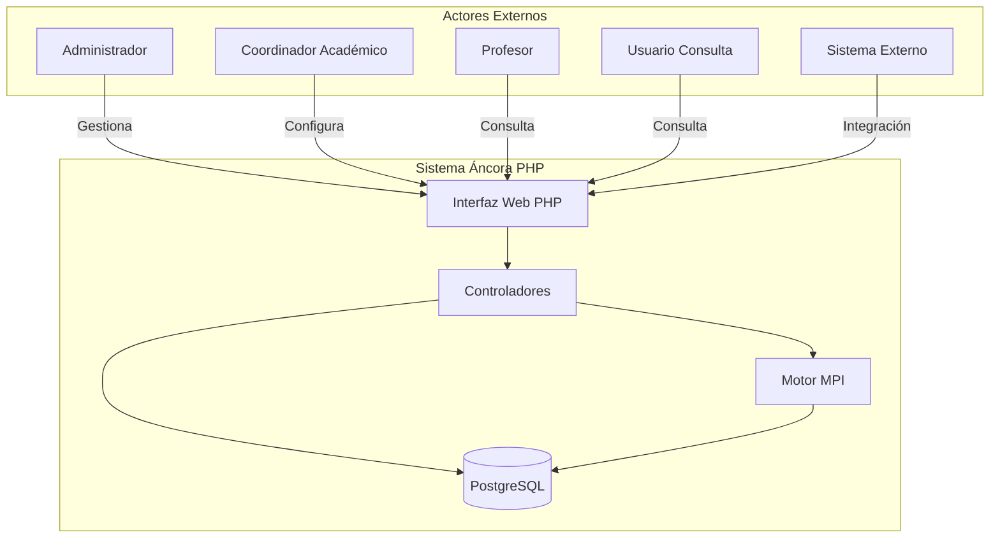
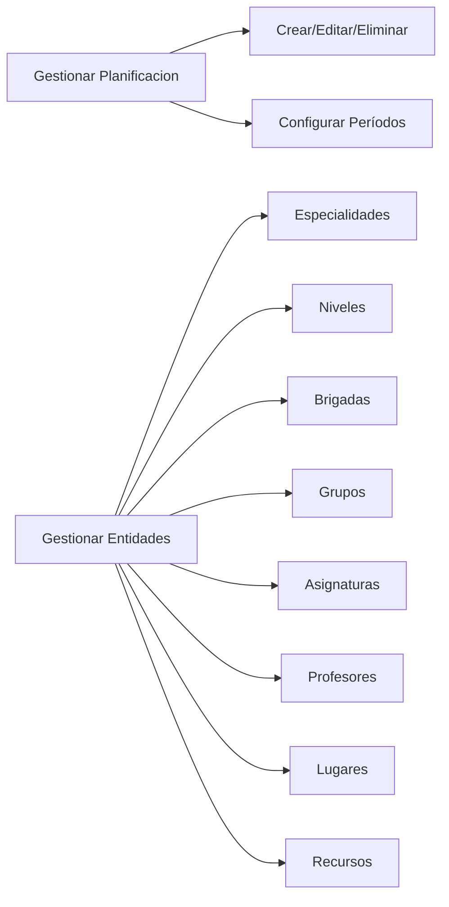
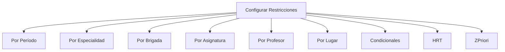
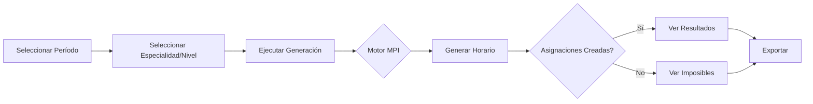
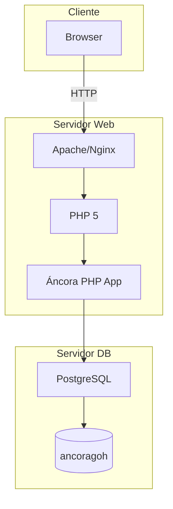

# 01. Modelo de Contexto

> Modelo de contexto del sistema Áncora PHP

---

## 1.1 Propósito del Sistema

**Áncora GOH PHP** es una aplicación web para la generación y gestión automatizada de horarios académicos en instituciones educativas.

### Declaración de Misión
> Automatizar la creación de horarios académicos conflict-free mediante la asignación inteligente de actividades a slots de tiempo, respetando restricciones físicas, temporales y humanas.

---

## 1.2 Actores Externos



### Actores Detallados

| Actor | Descripción | Rol |
|-------|-------------|-----|
| **Administrador** | Control total del sistema | Configura BD, usuarios, seguridad |
| **Coordinador** | Gestiona planificaciones | Crea/modifica horarios, restricciones |
| **Profesor** | Consulta disponibilidad | Ve su horario, restricciones |
| **Usuario Consulta** | Solo lectura | Consulta horarios generados |
| **Sistema Externo** | Integración | APIs para otros sistemas |

---

## 1.3 Casos de Uso Principales

### Gestión de Datos



### Configuración de Restricciones



### Generación de Horarios



---

## 1.4 Límites del Sistema

### Áncora PHP SÍ hace:
- ✅ Gestionar múltiples planificaciones
- ✅ CRUD completo de entidades
- ✅ Configurar restricciones complejas
- ✅ Generar horarios automáticamente
- ✅ Control de acceso multi-usuario
- ✅ Auditoría de acciones
- ✅ Consultar horarios generados

### Áncora PHP NO hace:
- ❌ Gestión de matrícula de estudiantes
- ❌ Facturación o pagos
- ❌ Registro de asistencia
- ❌ Integración directa con SIS
- ❌ Notificaciones automáticas
- ❌ Aplicación móvil

---

## 1.5 Dependencias Externas

### Infraestructura
| Dependencia | Versión | Propósito |
|-------------|---------|-----------|
| PHP | 5.2+ | Runtime |
| PostgreSQL | 8.x+ | Base de datos |
| Apache/Nginx | Cualquiera | Servidor web |

### Bibliotecas PHP
| Biblioteca | Propósito |
|------------|-----------|
| nusoap | Servicios web SOAP |
| jQuery | JavaScript (mencionado en www/js/) |

---

## 1.6 Modelo de Despliegue



---

## 1.7 Métricas del Sistema

| Métrica | Valor |
|---------|-------|
| Tablas en BD | 62 |
| Funciones SQL | 200+ |
| Foreign Keys | 140+ |
| Controladores PHP | 180+ |
| Vistas (templates) | 266 |
| Líneas PHP | ~40,000 |
| Líneas SQL | ~15,000 |

---

## 1.8 Contexto de Negocio

### Entidad Educativa Típica
```
Institución
└── Facultad/Escuela
    └── Carrera (Especialidad)
        └── Año (Nivel)
            └── Grupo/Brigada
                └── Subgrupos (Grupos)
```

### Flujo de Datos
```
Planificación
└── Período (Semana/Pares)
    ├── Estructura (Esp → Nivel → Brigadas)
    ├── Recursos (Profesores, Lugares, Equipos)
    ├── Contenido (Asignaturas → Desgloses → Actividades)
    ├── Restricciones (HRT, ZPriori, Condicionales)
    └── Resultado (Horario generado)
```

---

*Document Status: 🔄 In Progress*
*Next: Add detailed use cases*
