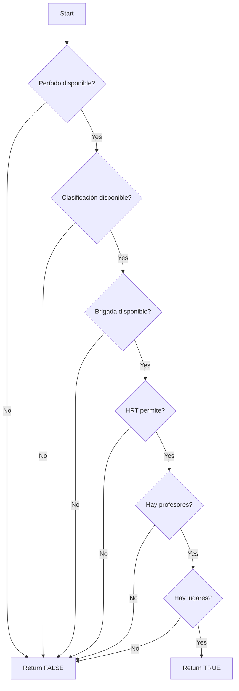

# Algoritmo MPI en PostgreSQL

> Documentación del motor de generación de horarios implementado como stored procedures

---

## 3.1 Visión General

El algoritmo **MPI (Matriz de Posibles Inicios)** fue migrado de VB6 a PostgreSQL como funciones almacenadas para mejorar el rendimiento y aprovechar el poder de procesamiento del servidor de BD.

### Ventajas de la Implementación SQL
- **Rendimiento**: Procesamiento en el servidor, reduce tráfico de red
- **Integridad**: Transacciones ACID garantizan consistencia
- **Reusabilidad**: Funciones pueden llamarse desde cualquier cliente
- **Mantenibilidad**: Lógica centralizada en la BD

---

## 3.2 Arquitectura del Generador

```mermaid
flowchart TB
    subgraph "Llamada PHP"
        P[PHP: genera('esp', 'nivel', 'per', ...)]
    end
    
    subgraph "PostgreSQL Functions"
        G[generar.sql]
        PI[posible_inicio.sql]
        AM[and_mpi.sql]
        AA[agrega_actividad.sql]
        
        G --> PI
        G --> AM
        G --> AA
    end
    
    subgraph "Tablas"
        T1[actividad]
        T2[restriccion_*]
        T3[brigada]
    end
    
    PI --> T2
    AM --> T3
    AA --> T1
```

---

## 3.3 Función Principal: generar()

```sql
-- dev/sql/generador/generar.sql
CREATE OR REPLACE FUNCTION generar(
    idesp VARCHAR,
    idnivel VARCHAR,
    idperiodo VARCHAR,
    forma INTEGER,           -- 1=primera fecha libre, 2=menor impacto, etc.
    parche BOOLEAN,         -- Bandera de compatibilidad
    compactar INTEGER,       -- 0=no compactar, 1=compactar
    parche1 BOOLEAN,
    buscalugar BOOLEAN
) RETURNS VOID AS $$
DECLARE
    -- Variables de control
    r RECORD;
    cancelar BOOLEAN;
BEGIN
    -- 1. Verificar si fue cancelado
    cancelar := generador.fue_cancelado(idesp, idnivel, idperiodo);
    IF cancelar THEN
        RAISE NOTICE 'Generacion cancelada';
        RETURN;
    END IF;
    
    -- 2. Para cada brigada en la especialidad/nivel
    FOR r IN SELECT * FROM brigada WHERE especialidad = idesp AND nivel = idnivel LOOP
        -- 3. Para cada grupo en la brigada
        FOR grupo IN SELECT grupo FROM brigada_de_grupo WHERE brigada = r.id LOOP
            -- 4. Para cada actividad pendiente
            -- 调用 posible_inicio y asignar
        END LOOP;
    END LOOP;
    
    RAISE NOTICE 'Generacion completada';
END;
$$ LANGUAGE plpgsql;
```

### Parámetros

| Parámetro | Tipo | Descripción |
|-----------|------|-------------|
| `idesp` | VARCHAR | ID de especialidad |
| `idnivel` | VARCHAR | ID de nivel |
| `idperiodo` | VARCHAR | ID de período |
| `forma` | INTEGER | Método de selección (1=primera libre, 2=menor impacto) |
| `parche` | BOOLEAN | Bandera de compatibilidad |
| `compactar` | INTEGER | Nivel de compactación (0-1) |
| `parche1` | BOOLEAN | Otro parche |
| `buscalugar` | BOOLEAN | Buscar lugar automáticamente |

---

## 3.4 Función: posible_inicio()

```sql
-- dev/sql/generador/posible_inicio.sql
CREATE OR REPLACE FUNCTION posible_inicio(
    idplantilla VARCHAR,
    dia INTEGER,
    turno INTEGER,
    idbrigada VARCHAR,
    plugares VARCHAR[],     -- Lugares sugeridos (NULL = buscar)
    pprofesores VARCHAR[]   -- Profesores sugeridos (NULL = buscar)
) RETURNS BOOLEAN AS $$
DECLARE
    duracion INTEGER;
    periodo VARCHAR;
    clasif VARCHAR;
    exige_lugar BOOLEAN;
    exige_profesor BOOLEAN;
    v INTEGER;
BEGIN
    -- 1. Obtener metadata de la plantilla
    duracion := dame_duracion_plantilla_de_actividad(idplantilla);
    periodo := dame_periodo_plantilla_de_actividad(idplantilla);
    clasif := dame_clasif_plantilla_de_actividad(idplantilla);
    
    exige_lugar := plantilla_exige_lugar(idplantilla);
    exige_profesor := plantilla_exige_profesor(idplantilla);
    
    -- 2. Verificar que el slot + duracion no exceda límites
    IF turno + duracion - 1 > dame_cant_turnos(periodo) THEN
        RETURN FALSE;
    END IF;
    
    -- 3. Para cada slot en la duración
    FOR i IN 0..duracion-1 LOOP
        -- Check período
        v := valor_restriccion_periodo(periodo, dia, turno + i);
        IF v > 0 THEN RETURN FALSE; END IF;
        
        -- Check clasificación
        v := valor_restriccion_clasif_act(clasif, periodo, dia, turno + i);
        IF v > 0 THEN RETURN FALSE; END IF;
        
        -- Check brigada
        v := valor_restriccion_brigada(idbrigada, periodo, dia, turno + i);
        IF v > 0 THEN RETURN FALSE; END IF;
        
        -- Check HRT (herencia)
        IF NOT herencia_permite(idbrigada, periodo, dia, turno + i) THEN
            RETURN FALSE;
        END IF;
        
        -- Check profesores y lugares
        IF exige_profesor AND pprofesores IS NULL THEN
            -- Buscar profesores disponibles
        END IF;
        IF exige_lugar AND plugares IS NULL THEN
            -- Buscar lugares disponibles
        END IF;
    END LOOP;
    
    -- 4. Verificar disponibilidad de profesores y lugares
    RETURN TRUE;
END;
$$ LANGUAGE plpgsql;
```

### Checks Realizados



---

## 3.5 Función: and_mpi()

Combina la disponibilidad de múltiples brigadas (todas deben estar disponibles).

```sql
-- dev/sql/generador/and_mpi.sql
CREATE OR REPLACE FUNCTION and_mpi(
    idplantillas VARCHAR[],
    dia INTEGER,
    turno INTEGER,
    idbrigadas VARCHAR[]
) RETURNS BOOLEAN AS $$
DECLARE
    i INTEGER;
BEGIN
    FOR i IN 1..array_length(idplantillas, 1) LOOP
        IF NOT posible_inicio(idplantillas[i], dia, turno, idbrigadas[i], NULL, NULL) THEN
            RETURN FALSE;
        END IF;
    END LOOP;
    RETURN TRUE;
END;
$$ LANGUAGE plpgsql;
```

### Lógica
```
MPI(A) = [✓][✗][✓][✓]
MPI(B) = [✓][✓][✗][✓]
─────────────────────
AND    = [✓][✗][✗][✓]  -- Solo slots donde AMBAS brigadas están disponibles
```

---

## 3.6 Función: agrega_actividad()

```sql
-- dev/sql/generador/agrega_actividad.sql
CREATE OR REPLACE FUNCTION agrega_actividad(
    idplantilla VARCHAR,
    idgrupo VARCHAR,
    idprofesor VARCHAR,
    idlugar VARCHAR,
    dia INTEGER,
    turno INTEGER
) RETURNS VOID AS $$
DECLARE
    duracion INTEGER;
    i INTEGER;
BEGIN
    -- 1. Obtener duración de la plantilla
    duracion := dame_duracion_plantilla_de_actividad(idplantilla);
    
    -- 2. Crear registro de actividad
    INSERT INTO actividad (
        id,
        plantilla,
        grupo,
        profesor,
        lugar,
        dia,
        turno,
        momento_de_colocacion,
        creador
    ) VALUES (
        genera_id_unico(),
        idplantilla,
        idgrupo,
        idprofesor,
        idlugar,
        dia,
        turno,
        EXTRACT(EPOCH FROM NOW()),
        current_user
    );
    
    -- 3. Marcar restricciones como usadas
    FOR i IN 0..duracion-1 LOOP
        UPDATE restriccion_de_profesor 
        SET valor = 1 
        WHERE profesor = idprofesor 
        AND dia = dia 
        AND turno = turno + i;
        
        UPDATE restriccion_de_lugar 
        SET valor = 1 
        WHERE lugar = idlugar 
        AND dia = dia 
        AND turno = turno + i;
        
        UPDATE restriccion_de_brigada 
        SET valor = 1 
        WHERE EXISTS (
            SELECT 1 FROM grupo g 
            JOIN brigada_de_grupo bg ON g.id = bg.grupo 
            WHERE bg.brigada = (SELECT brigada FROM grupo WHERE id = idgrupo)
            AND g.id = idgrupo
        )
        AND dia = dia 
        AND turno = turno + i;
    END LOOP;
    
END;
$$ LANGUAGE plpgsql;
```

---

## 3.7 Funciones Auxiliares

### Selección de Lugar Óptimo

```sql
-- busca_lugar_menos_costoso.sql
CREATE OR REPLACE FUNCTION busca_lugar_menos_costoso(
    lugares_disponibles VARCHAR[],
    dia INTEGER,
    idbrigada VARCHAR
) RETURNS VARCHAR AS $$
DECLARE
    lugar RECORD;
    min_costo BIGINT;
    mejor_lugar VARCHAR;
BEGIN
    min_costo := BIGINT '9223372036854775807';
    
    FOR lugar IN SELECT * FROM lugar WHERE id = ANY(lugares_disponibles) LOOP
        -- Calcular costo de traslado desde lugar anterior
        costo := dame_costo_trasladar(
            lugar_anterior_en_dia(dia, idbrigada),
            lugar.id
        );
        
        IF costo < min_costo THEN
            min_costo := costo;
            mejor_lugar := lugar.id;
        END IF;
    END LOOP;
    
    RETURN mejor_lugar;
END;
$$ LANGUAGE plpgsql;
```

### Verificación de Capacidad

```sql
-- quita_segun_capacidad.sql
CREATE OR REPLACE FUNCTION quita_segun_capacidad(
    lugares VARCHAR[],
    matricula INTEGER
) RETURNS VARCHAR[] AS $$
DECLARE
    resultado VARCHAR[];
    lugar RECORD;
BEGIN
    resultado := '{}';
    
    FOR lugar IN SELECT * FROM lugar WHERE id = ANY(lugares) LOOP
        IF lugar.capacidad >= matricula THEN
            resultado := array_append(resultado, lugar.id);
        END IF;
    END LOOP;
    
    RETURN resultado;
END;
$$ LANGUAGE plpgsql;
```

---

## 3.8 Funciones de Restricción

### valor_restriccion_*()

```sql
-- Verificar restricción de período
CREATE OR REPLACE FUNCTION valor_restriccion_periodo(
    idperiodo VARCHAR,
    dia INTEGER,
    turno INTEGER
) RETURNS INTEGER AS $$
    SELECT COALESCE(valor, 0)
    FROM restriccion_de_periodo
    WHERE periodo = idperiodo
    AND dia = dia
    AND turno = turno;
$$ LANGUAGE sql;

-- Similar para: brigada, profesor, lugar, asignatura, clasificacion, etc.
```

### herencia_permite()

```sql
-- Verificar herencia de restricciones
CREATE OR REPLACE FUNCTION herencia_permite(
    idhijo VARCHAR,
    idperiodo VARCHAR,
    dia INTEGER,
    turno INTEGER
) RETURNS BOOLEAN AS $$
DECLARE
    r RECORD;
BEGIN
    FOR r IN SELECT * FROM herencia_de_restricciones 
             WHERE activa = TRUE LOOP
        -- Verificar si hijo hereda del padre
        IF r.hijo_brigada = idhijo THEN
            -- Verificar si el padre tiene restricción
            IF valor_restriccion_periodo(r.padre_periodo, dia, turno) > 0 THEN
                -- Verificar si hay excepción
                IF NOT EXISTS (
                    SELECT 1 FROM excepcion_de_hrt
                    WHERE herencia = r.id
                    AND dia = dia
                    AND turno = turno
                ) THEN
                    RETURN FALSE;
                END IF;
            END IF;
        END IF;
    END LOOP;
    RETURN TRUE;
END;
$$ LANGUAGE plpgsql;
```

---

## 3.9 Catalogación de Funciones SQL

| Archivo | Funciones | Propósito |
|---------|-----------|-----------|
| `posible_inicio.sql` | `posible_inicio()` | Verifica si slot es válido |
| `and_mpi.sql` | `and_mpi()` | Combina disponibilidad |
| `generar.sql` | `generar()` | Orquestador principal |
| `agrega_actividad.sql` | `agrega_actividad()` | Crea asignación |
| `busca_lugar_mas_utilizado_por.sql` | `busca_lugar_mas_utilizado_por()` | Lugar más usado |
| `busca_lugar_menos_utilizado_por.sql` | `busca_lugar_menos_utilizado_por()` | Lugar menos usado |
| `busca_lugar_menos_costoso.sql` | `busca_lugar_menos_costoso()` | Lugar óptimo por costo |
| `dame_costo_trasladar_recurso.sql` | `dame_costo_trasladar_recurso()` | Costo de traslado |
| `dame_gasto_lugares_en_el_dia.sql` | `dame_gasto_lugares_en_el_dia()` | Lugares usados |
| `dame_lugares_usados_alrededor_de.sql` | `dame_lugares_usados_alrededor_de()` | Lugares vecinos |
| `dia_minimo_impacto.sql` | `dia_minimo_impacto()` | Mejor día |
| `extraer_lugares_que_no_permanecen.sql` | `extraer_lugares_que_no_permanecen()` | Filtro |
| `get_max_colocation.sql` | `get_max_colocation()` | Máxima ubicación |
| `lugar_permanece_en.sql` | `lugar_permanece_en()` | Verificar lugar |
| `quita_segun_capacidad.sql` | `quita_segun_capacidad()` | Filtro capacidad |
| `quita_segun_prohibidos.sql` | `quita_segun_prohibidos()` | Filtro prohibidos |
| `rango.sql` | `rango()` | Calcular rango válido |
| `TRango.sql` | `TRango()` | Tipo rango |

---

## 3.10 Llamada desde PHP

```php
// www/test.php (ejemplo)
<?php
if (isset($_POST['generar'])) {
    // Llamar función generar() en PostgreSQL
    $sql = "SELECT generar(
        '{$idesp}',
        '{$idnivel}', 
        '{$idperiodo}',
        1,      // forma
        true,   // parche
        1,      // compactar
        false,  // parche1
        false   // buscalugar
    )";
    
    pg_send_query($db, $sql);
    // Esperar resultado...
}
?>
```

---

*Document Status: 🔄 In Progress*
*Next: Add execution flow diagram*
