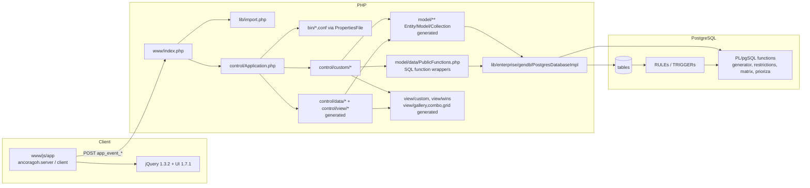

# Existing PHP architecture and request/data flow

Scope: the PHP/JavaScript side of the July 2010 snapshot (`b42aa03`, `f5cc46e`). Database internals are in [database-assessment.md](database-assessment.md). Evidence labels are defined in [assessment.md](assessment.md) §1. Line numbers refer to the current `master` (`2881353`).

## 1. Repository map (observed)

| Path | Files | Role | Generated? |
| --- | --- | --- | --- |
| `www/index.php` | 1 | Single front controller (HTML shell + AJAX endpoint) | No |
| `www/path.php`, `lib/import.php` | 2 | `import("a.b.c")` dotted-path include loader (`.php/.lib/.conf/.tpl/.frm`) | No |
| `control/Application.php` | 1 | Session, login, permission lookup, event dispatch | No |
| `control/Connection.php` | 1 | Alternative DB bootstrap (CLI scripts) | No |
| `control/data/{add,set,del}` | 61 each | POST → entity INSERT/UPDATE/DELETE receivers | Yes (`cogephp`, 20/06/10) |
| `control/data/fdms` | 11 | "Field data modifiers" injected before add/set (e.g. `creador` = session user) | No |
| `control/view/{combo,gallery}` | 61 each | Generic combo/gallery fragments | Yes |
| `control/custom` | 101 | Hand-written handlers: browsers, forms, mini-browsers, generator, priorities, restrictions | No |
| `model/data` | 164 + 2 | Per table: `<Entity>.php`, `<Entity>Model.php` (DAO), `<Entity>Collection.php`; `PublicFunctions.php` (181 SQL function wrappers); `services/PersonsService.php`; `views/PublicDatabaseViews.php` | Yes |
| `model/security`, `model/generator`, `model/util` | 19 + 4 + 2 | Same pattern for `seguridad.*`, `generador.*`, `matrix.*`/`prioriza.*` wrappers | Yes |
| `model/AncoraGOH.{creator,dropper}.sql` | 2 | DDL emitted by the code generator from its JSON model (uses pseudo-types `string`, `replica`; **not installable SQL**) | Yes |
| `view/{combo,gallery,grid}` | 61 each | Generated templates | Yes |
| `view/custom` | 84 | Hand-written templates (forms, browsers, ribbon, generator window, timetable grid) | No |
| `view/wins` | 7 | Window definitions (organization, plans, resources, breakdowns, timetable explorer, public) | No |
| `www/js/app` | ≈40 | Client: `ancoragoh.server.*` (AJAX calls), `ancoragoh.client.*` (windows, forms, browsers) | No |
| `www/js/jquery` | ≈100 + archives | Vendored jQuery 1.3.2, jQuery UI 1.7.1, plugins, demos, `.zip/.tar.gz` downloads | Third-party |
| `lib/basic`, `lib/ancora`, `lib/enterprise`, `lib/parsers` | ≈35 | Utilities, time utilities, DB abstraction (`gendb`), NuSOAP, JSON/XML parsers | Mixed |
| `bin/` | 8 | CLI user tools, `ancoragoh.conf` (DB connection), `security.conf` (event→permission map) | No |
| `dev/` | many | Code generator `cogephp*.php`, `crea_modelo_pg.php`, JSON model under `dev/src/`, SQL sources `dev/sql/`, DB backups `dev/backup/` | Tooling |
| `docs/` | 6 | Spanish documentation added April 2026 (illustrative, partly inaccurate; see assessment.md §7) | — |

## 2. Request lifecycle (observed)

```mermaid
sequenceDiagram
    participant B as Browser (jQuery UI desktop)
    participant I as www/index.php
    participant A as control/Application.php
    participant H as control/<dir>/<event>.php
    participant M as model/* (Entity/Model/Collection)
    participant DB as PostgreSQL (functions, rules, triggers)
    B->>I: GET index.php (first load)
    I->>I: session_start(); include view/custom/header.tpl (JS/CSS imports)
    I->>DB: pg_connect(bin/ancoragoh.conf)
    I->>A: Run()
    A-->>B: authform.tpl, or app.tpl (ribbon + windows) if $_SESSION['user']
    B->>I: POST index.php?execute  {app_event_<name>: "yes", field_<Entity>_<col>: ..., [access: "public"]}
    I->>A: Run() (no header/footer when ?execute)
    A->>A: VerifyLogin / permissions (see §4)
    A->>H: include first existing ../control/{data/add,data/set,data/del,view/gallery,view/combo,custom}/<name>.php
    H->>M: new Entity(..., construct=true) → Model::add() builds SQL string
    M->>DB: pg_query(string SQL)
    DB-->>M: rows / side effects via RULEs/TRIGGERs
    H-->>B: HTML fragment (include view/... .tpl), loaded into a window/div by ajax_load_html
```

Key facts:

- **One endpoint, many events.** `Application::executeEvents()` (`control/Application.php:155-190`) scans every POST key starting with `app_event_` whose value is not `"no"`, strips the prefix, and includes the first matching file among six folders. Several events can run in one request, in POST order.
- **Responses are HTML fragments**, not JSON. Client code in `www/js/app/lib/ancoragoh_ajax_util.js` (`ajax_execute_event`, line 78; `ajax_load_html`) posts to `index.php?execute` and injects the response.
- **Persistence is driven by object construction.** E.g. `control/data/add/add_Especialidad.php` only does `new Especialidad($descripcion, $creador, ..., true)`; the constructor calls `EspecialidadModel::add()` which interpolates values into an `INSERT` (`model/data/EspecialidadModel.php:30-36`). Setters issue one `UPDATE` per property; getters re-`SELECT` the row on every call (`model/data/Especialidad.php:42-67`).
- **IDs are generated client-side in PHP** by `getReplica()` (`lib/basic/string/StringUtils.php:13-23`): prefix + `d/m/y h:i:s` + `time()` + 50–100 random chars from `rand()`. DB-side defaults use `crear_id_de_replica()` (broken in sources, see database-assessment.md §6.7).
- **Database errors are not handled.** `PostgresDatabaseImpl::getDefault()` returns `pg_query()` without checking for failure (`lib/enterprise/gendb/PostgresDatabaseImpl.php:27-35`); `getAsObjects()` then iterates a `false` result. `index.php` hard-codes `$dberror = false` and never inspects `Connect()`'s return value, so the designed "database unavailable" screen (wiki *Deployment-and-Errors*) cannot appear.
- **No transactions** are opened from PHP; multi-statement operations (e.g. group/brigade moves) are not atomic.
- The generator request (`control/custom/generar.php`) calls `set_time_limit(0)` and runs `SELECT public.generar(...)` synchronously inside the HTTP request.

## 3. Event wiring (observed, literal cross-reference)

Method: all string literals `app_event_<name>` in `www/js`, `view`, `control`, `model` were matched against handler files in the six event folders.

| Folder | Handlers | Referenced from client | Notes |
| --- | --- | --- | --- |
| `control/data/add` | 61 | 16 | Unreferenced include `add_Actividad`, `add_Restriccion*`, `add_HerenciaDeRestricciones`, `add_Higiene*`, `add_CostoDeTraslado`, `add_Usuario`, `add_Rol`, `add_Permiso`, `add_Host`, `add_Traza` |
| `control/data/set` | 61 | 15 | Same pattern |
| `control/data/del` | 61 | 17 | Same pattern |
| `control/view/gallery` | 61 | 0 | Also defective: instantiate the entity instead of the collection and include a non-existent `../view/gallery_grid_*.tpl` |
| `control/view/combo` | 61 | 0 | — |
| `control/custom` | 101 | 97 | Unreferenced: `custom_getui_DesgloseSelectPlanificacion`, `custom_getui_NuevaEspecialidad`, `custom_set_Restricciones`, `get_minibrowser_desgloses_planificaciones` |

Referenced events with **no handler**: `custom_getui_DesglosePropiedades`, `custom_getui_EditarGrupo`, `custom_getui_EditarPlantillaDeActividad`, `get_browser_Especialidades` (and a dynamic `prefix` construction). Dynamic name construction may hide a few more references; the counts are a lower bound for "used".

Conclusion: the **live application surface is ≈145 events**, concentrated in `control/custom`. The generated CRUD layer is mostly scaffolding; ≈330 generated handlers are dead code that still increases the attack surface (they are reachable by name, see §4).

## 4. Authentication, authorization and sessions (observed)

| Mechanism | Location | Observation | Severity |
| --- | --- | --- | --- |
| Login | `control/Application.php:29-48` | `md5($password)` and `getAllBy("nick = '$user' AND contrasena = '$pass'")` — unsalted MD5 and **SQL injection on `$user`** | Critical |
| Public access | `control/Application.php:197-201` | If `POST access=public`, `executeEvents()` runs **without any session check**. Permissions resolve to an empty set for an anonymous user, and the only gate is `bin/security.conf` (below), so every handler — including add/set/del — is executable anonymously | Critical |
| Event→permission map | `bin/security.conf`, `lib/basic/file/PropertiesFile.php:23-32`, `control/Application.php:164-181` | `PropertiesFile` computes the array name with `substr($prop, 0, $p - 1)`, dropping the last character (`event_permission`), so `properties['event_permissions']` never exists and **no event permission is ever enforced**. The two configured event names (`get_form_editEspecialidad`, `get_form_editPlanificacion`) also do not match handler names (`get_form_edit_Especialidad`, …) | Critical |
| Role/permission lookup | `control/Application.php:82-127` | String-interpolated SQL using `$_SESSION['user']` and role names; superuser via permission `todos` (`dev/sql/datos/datos_por_defecto.sql`) | Medium |
| Host restriction | `seguridad.host`, `seguridad.check_host` | Not called from PHP — **not enforced** | Gap |
| Audit trace | `seguridad.traza` | No writer in the live surface (only the unreferenced generated `add_Traza`) — **not implemented** | Gap |
| Data ownership | e.g. `control/custom/custom_getui_ExploradorHorarios.php` | Some views filter `creador = $_SESSION['user']`; mutations do not check ownership | High |
| CSRF | — | None; state changes via POST from any origin | High |
| Session | `www/index.php:2` | `session_start()` with defaults; no regeneration on login; no `session_write_close()` before long work (see §6) | Medium |
| Default account | `dev/sql/datos/datos_por_defecto.sql` | `admin` / `md5('changeit')`, role `superusuario` | Must change at install |
| CLI tools | `bin/adduser.php` etc. | Include non-existent paths (`../lib/console.lib`, `../modelo/*.php`) — **broken** | Low |

## 5. Security-sensitive and deprecated patterns (static scan)

| Pattern | Files / hits | Where | Impact |
| --- | --- | --- | --- |
| SQL built by string interpolation from request/session data | Pervasive; 54 direct `$_POST/$_SESSION` interpolations in `control/` + `model/`, plus every generated `Model::add/setBy/getAllBy` | e.g. `control/custom/get_minibrowser_horarios.php` (`idbrg`, `idprofe`, `idperiodo`), `model/data/PublicFunctions.php:1555` (`generar`) | SQL injection, also by authenticated users |
| `eval` of request-derived strings | 61 gallery templates | `view/gallery/gallery_*.tpl:22,24` (`$fieldlink` is taken from `$_POST['link']` by the gallery controllers) | Code injection; reachability currently limited by the controllers' own crash (§3) |
| `eval` of configuration values | `lib/basic/file/PropertiesFile.php:29-36` | Every config line is executed as PHP | Config file = code |
| Committed secrets | `bin/ancoragoh.conf` (DB password), `dev/cogephp.conf` (DB password), `dev/backup/drop_database.php` (superuser password); `dev/backup/ancoragoh.sql` (user row with MD5 hash) | — | Rotate any reused credential; purge from history decision needed |
| Logged SQL with IDs | `www/query.log` (committed); `PostgresDatabaseImpl::getDefault($debug)` writes `query.log` in the web root | — | Information leak |
| PHP-4 constructors (`function ClassName()`) | 210 of 219 classes | all generated entities/models, `PartModel`, `PropertiesFile`, … | **PHP 8: no longer constructors** → objects silently unconstructed |
| Undefined constants (`descripcion==null?…`) | 328 expressions in 61 model files | `model/data/*Model.php` `add()` | **PHP 8: fatal `Error`**; PHP 7: warning, always-false comparison |
| `var` properties | 1,116 | everywhere | Works; style only |
| Curly-brace string offsets | 15 in `lib/parsers/json/JSON.php` | — | **PHP 8 parse error** |
| `=& new`, `ereg*`, `split`, `$HTTP_*_VARS`, `set_magic_quotes_runtime` | NuSOAP (`lib/enterprise/nusoap/*`), `lib/enterprise/network/NetworkUtils.php` | — | Parse errors / removed functions; NuSOAP appears unused by the live surface |
| `mysql_*` | `lib/enterprise/gendb/MySQLDatabaseImpl.php` | unused alternative driver | Removed extension |
| Typos producing runtime errors | `model/data/PartModel.php:57` (`$this-getAnything`, missing argument) | — | Broken search helper |
| No output escaping in templates | e.g. `view/custom/minibrowser_horarios.tpl` echoes names directly | — | Stored XSS |

`php -l` (PHP 8.4.27) passes for 935 of 939 PHP/template files; the 4 parse errors are all in vendored libraries. **Passing lint does not mean PHP 8 compatibility**: the constructor and undefined-constant issues are runtime failures.

## 6. Long-running generation, cancellation and concurrency (observed + hypotheses)

- `generar()` runs as **one SQL statement in one transaction** inside the HTTP request. Placements become visible to other sessions only at commit.
- Cancellation is cooperative: `cancelar_generacion` inserts `(esp, nivel, periodo)` into `generador.cancelar`; `generar` polls `generador.fue_cancelado()` (which deletes the row when found) hundreds of times per activity. **Verified** in the experiment DB: a pre-inserted cancel row makes `generar` return immediately and the flag is consumed.
- **Hypothesis (UI cancel blocked):** PHP's default file session handler holds an exclusive lock on the session file for the whole request (`www/index.php:2`, no `session_write_close()` anywhere). The cancel AJAX request from the same browser session should block until the generation request ends, making UI cancellation ineffective. Needs an HTTP-level reproduction.
- **Hypothesis (double booking):** occupancy is recorded by inserting per-activity restriction rows (RULE `actualiza_restricciones_por_actividad`, `dev/sql/ancoragoh.sql:126-129`). Two concurrent generations sharing teachers/places cannot see each other's uncommitted rows and there is no explicit locking, so double booking across concurrent runs is possible.
- Partial results after cancel are **committed** (function returns normally), which matches the historical "anchor" (stop/continue) intent; a crash or statement timeout rolls back everything.

## 7. Client architecture (observed)

- `view/custom/header.tpl` loads jQuery 1.3.2, jQuery UI 1.7.1 components and effects, bgiframe, a Gantt plugin, then ~40 application scripts.
- Namespaces: `ancoragoh.server.<entity>` (thin AJAX wrappers, e.g. `www/js/app/server/ancoragoh_server_especialidades.js`), `ancoragoh.client.browsers.*`, `ancoragoh.client.forms.*`, `ancoragoh.client.wins.generador`.
- UI metaphor: ribbon (`view/custom/ribbon.tpl`) opening windows (`view/wins/*.php`) — planning, organization, resources, breakdowns, resource assignment, timetable explorer, public view, generator queue/strategy (`view/custom/win_generador.tpl`).
- Timetable rendering (`view/custom/minibrowser_horarios.tpl`) is a read-only day×slot table showing only the **start cell** of each activity (multi-slot activities are not spanned; a second activity in the same cell overwrites the first) with random colors per subject.

## 8. Module dependency map (observed)



Code generation: `dev/cogephp.php` builds `model/**`, `control/data/**`, `control/view/**`, `view/{combo,gallery,grid}` and `model/AncoraGOH.*.sql` from JSON models in `dev/src/*.json` (`dev/crea_modelo_pg.php` extracts those JSON models from a live PostgreSQL database; settings in `dev/cogephp.conf`). The generated `PublicFunctions.php` wraps 181 functions, including PostgreSQL debugger functions (`pldbg_*`) and helpers absent from `dev/sql` (`concat`, `first`, `greatest`, `if`, `rand`, `actualiza_orden_actividades`), proving it was generated from a live database that diverged from the SQL sources.

## 9. Component status

| Component | Status | Evidence |
| --- | --- | --- |
| Front controller, import loader, event dispatch | Complete (legacy design), insecure | §2–4 |
| Login / logout / session expiry message | Complete, insecure | `Application.php` |
| RBAC (roles, permissions, `security.conf`) | Partial — data model present, enforcement broken | §4 |
| Host restriction, audit trace | Schema only | §4 |
| Generated CRUD layer | Complete as scaffolding; ~70% unreferenced; PHP 8 incompatible | §3, §5 |
| Custom planning/authoring UI (plans, periods, organization, subjects, templates, resources, priorities, zone priorities, period restrictions, travel cost form) | Implemented, untested | `control/custom`, `view/custom` |
| Generator window (queue, strategy options, cancel) | Implemented, untested end-to-end | `view/custom/win_generador.tpl`, `ancoragoh_server_generador.js` |
| Timetable explorer / guest view | Implemented read-only, limited rendering | §7 |
| Manual timetable editing, analyses, reports, export/print | Missing | functional-inventory.md |
| CLI user tools | Broken | §4 |
| NuSOAP / MySQL driver / XML parser | Present, apparently unused | grep: no live references |
| `dev/` code generator | Present, depends on legacy runtime; regenerates the defects | §8 |

## 10. Third-party and vendored inventory (license status)

| Component | Version (observed) | Location | License (as declared in file or upstream) | Status |
| --- | --- | --- | --- | --- |
| jQuery | 1.3.2 (also older copies inside plugin demos: 1.1–1.3.0) | `www/js/jquery/jquery.js`, plugin folders | MIT/GPL dual (upstream at that version) | Unmaintained; known XSS CVEs for < 3.5 |
| jQuery UI | 1.7.1 | `www/js/jquery/ui` | MIT/GPL dual | Unmaintained |
| bgiframe, cookie, jsdiff, qunit, simulate | bundled with jQuery UI | `www/js/jquery/external` | per plugin headers | Test/demo files included |
| jquery.gantt | unknown | `www/js/jquery/jquery.gantt*` (+ `.zip`, example HTML) | **Unverified** | Provenance needed |
| jquery-treeview | unknown | `www/js/jquery/jquery-treeview` (+ demo) | MIT/GPL (upstream) — verify header | Loaded commented out |
| jquery.sparkline, jqBarGraph, csv2table | unknown | `www/js/jquery/` | **Unverified** | Not loaded by `header.tpl` |
| flot 0.6, jgcharts 0.97 | archives only | `www/js/jquery/*.tar.gz, *.zip` (two identical jgcharts zips) | flot MIT; jgcharts **unverified** | Downloads committed to the web root |
| NuSOAP | 1.114 (2007) | `lib/enterprise/nusoap` | LGPL 2.1 (upstream) | PHP 8 parse errors; unused |
| Services_JSON (PEAR) | 1.31 (2006) | `lib/parsers/json/JSON.php` | BSD (declared in file) | PHP 8 parse error; PHP has native `json_*` |
| Icons, wallpapers | — | `www/images/**` (~130 images, wallpapers 0.6–1.9 MB) | **Unknown** | Provenance needed before redistribution |
| Áncora code itself | — | whole repository | **No LICENSE file**; README states "GPL v3 (inherited from VB6)"; VB6 LICENSE was added in 2026 | Maintainer decision and author consent needed |

The PostgreSQL debugger (`pldbgapi`) objects in the historical dump are an environment dependency of the 2010 developer database, not of the application.
