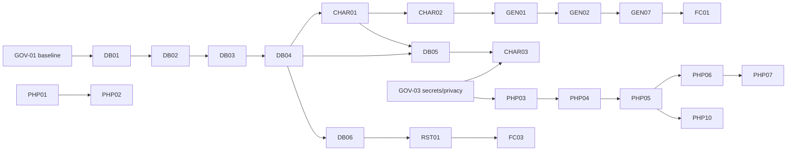

# Proposed modernization roadmap

These are **proposals for the maintainer**, derived from [assessment.md](assessment.md), [architecture.md](architecture.md), [database-assessment.md](database-assessment.md) and [functional-inventory.md](functional-inventory.md). No GitHub issues were created. Each task is meant to be one reviewable PR. IDs are stable labels for discussion only.

Guiding rules (from epic #1): preserve historical semantics and the MPI/Prioriza algorithms; separate *behavior-preserving* changes from *defect fixes* (each defect fix needs a characterization test and explicit approval); no framework, solver or architecture replacement without a separate decision.

## 1. Target runtime recommendation (candidates, not decisions)

| Runtime | Candidate | Evidence in this assessment | Rationale | To confirm |
| --- | --- | --- | --- | --- |
| PHP | **8.4** as baseline (8.3 as minimum floor) | Codebase linted with PHP 8.4.27: 935/939 files parse; blockers are known and mechanical (PHP-4 constructors, undefined constants, curly offsets, vendored libs) | Maintained branch with the longest remaining security support at the time of writing; no feature of 8.4 is required, so an 8.3 floor keeps distribution packages usable | Upstream support dates at decision time; CI matrix 8.3/8.4 (and 8.5 informational) |
| PostgreSQL | **16** as baseline, CI also on 17 | Historical dump restores on 16.15; sources install on 16 after mechanical repairs; full behavior reproduced on 16 with `plpgsql.variable_conflict = use_variable` | Widely packaged (Ubuntu 24.04 ships 16); nothing in the code needs newer features; PG ≥ 15 rules out `0THEN`-style literals already found | Run the installer and characterization suite on 17/18 before widening support |
| Browser JS | Keep jQuery initially, upgrade to jQuery 3.7 + jQuery UI 1.13 in a dedicated UI task | jQuery 1.3.2/UI 1.7.1 unmaintained with known XSS issues | Smallest behavior-preserving step; framework choice deferred (§4) | UI regression checklist |

PHP 5.x / PostgreSQL 8.x were **not** tested (no runtimes available); the historical behavior baseline is instead captured by the compatibility setting and the 2010 dump.

## 2. Sequenced task list

Order key: tasks in the same wave can run in parallel. "Behavior" column: **P** = behavior-preserving, **D** = defect fix requiring approval, **N** = new/recovered functionality.

### Wave 0 — Governance prerequisites (documentation/decisions)

| ID | Objective | Exact scope | Prerequisites | Acceptance criteria | Behavior |
| --- | --- | --- | --- | --- | --- |
| GOV-01 | Decide the database baseline | Written decision: 2010 dump vs `dev/sql` sources vs reconciled set; record the 18-function diff (database-assessment.md §4.5) | This assessment | Decision recorded in `docs/modernization/` or wiki; list of objects to take from each source | — |
| GOV-02 | License and provenance statement | Add LICENSE decision (after author consent), third-party inventory with licenses (architecture.md §10), image provenance, note on VB6 relation | Maintainer decision | LICENSE file + `THIRD-PARTY.md`; unresolved items explicitly marked | — |
| GOV-03 | Secrets and privacy remediation plan | Inventory: `bin/ancoragoh.conf`, `dev/cogephp.conf`, `dev/backup/drop_database.php`, `dev/backup/ancoragoh.sql` (user row, names), `www/query.log`; decide rotation and whether to rewrite history | — | Written plan; credentials rotated outside the repo if reused anywhere; decision on history rewrite | — |
| GOV-04 | Behavior-change policy | Define how verified defects (database-assessment.md §6) are approved: characterization test first, ADR-style note, changelog entry vs 2010 behavior | — | Policy page; template for defect-fix PRs | — |

### Wave 1 — Reproducible database installation (Phase 2 foundations)

| ID | Objective | Exact scope | Prerequisites | Acceptance criteria | Behavior |
| --- | --- | --- | --- | --- | --- |
| DB-01 | Make SQL sources parse | Fix the two DDL syntax errors (`organizacion/grupo.sql:4`, `actividad/plantilla_de_actividad.sql:10`), `0THEN`, remove BOMs, remove `CREATE/DROP LANGUAGE`, fix `dame_lista_id_otros_recursos_usados.sql:8`, `restringe_por_uso_de_otro_recurso.sql` (loop + `crear_id_de_replica` call), `crear_cadena_aleatoria.sql:33` (`RETURN cadena`, as in the dump) | GOV-01 | Every file in the chosen baseline compiles on PG 16 with `check_function_bodies = on`; diff limited to the listed lines | P (restores 2010 dump behavior) |
| DB-02 | Complete and correct the install manifest | Add omitted objects (30 functions, `generador/esquema_generador.sql`, `ancoragoh.sql` rules), fix dependency typos and the `grupo` ordering in `deploy.priority` | DB-01 | Fresh install on empty PG 16 with `ON_ERROR_STOP=1` succeeds; object counts match the GOV-01 baseline | P |
| DB-03 | Replace the bundler | Port or rewrite `compilasql.php` as a deterministic script (PHP 8 or shell) with strict dependency resolution (unknown dependency = error) and BOM stripping; delete the stale `result.sql` from version control or regenerate it in CI | DB-02 | Same output on two runs; fails loudly on a typo'd dependency; documented command | P |
| DB-04 | CI: install from empty database | GitHub Actions job: PG 16 (+17) service, run installer, run smoke query (`select count(*) from pg_proc …`) | DB-03 | Green pipeline on PR; badge/documentation | P |
| DB-05 | Fix PL/pgSQL name collisions | Rename conflicting parameters (`id`, `periodo`, `dia`, `turno`, …) or add `#variable_conflict use_variable` per function; remove reliance on the session setting | DB-04, CHAR-01 | Characterization suite gives identical results with the setting off vs on; no `ambiguous` errors | P |
| DB-06 | Type-safe `iif` usage | Add explicit casts where `iif` receives two untyped literals (`dame_tipo_hijo_hrt`, `dame_tipo_padre_hrt`, others found by grep) | DB-04 | HRT evaluation runs on PG 16 without polymorphic errors | P |
| DB-07 | Developer bootstrap | `docker compose` or script creating an ephemeral DB with installer + synthetic fixture; secrets via environment | DB-04 | One command brings up a DB with fixture; documented in README | P |
| DB-08 | Migration framework decision | Compare plain ordered SQL migrations vs a tool (e.g. Sqitch, Phinx, Flyway); no adoption yet | DB-04, GOV-01 | Short comparison document and recommendation | — |

### Wave 2 — Characterization and regression tests

| ID | Objective | Exact scope | Prerequisites | Acceptance criteria | Behavior |
| --- | --- | --- | --- | --- | --- |
| CHAR-01 | SQL characterization suite | Tests (pgTAP or plain SQL assertions) for `valor_restriccion_*`, `posible_inicio`, `and_mpi`, `prioriza.nivelar(_matrix)`, `rango`, `get_max_colocation`, occupancy rules, cancel, continuation; synthetic fixture from database-assessment.md §6 | DB-04 | Runs in CI; records current outputs including known-defect outputs (marked) | P |
| CHAR-02 | Defect tests as expected failures | One test per verified defect §6.2–6.9, 6.17, 6.19, 6.22–6.23, each with a timeout | CHAR-01 | Tests exist, are skipped/xfail with a link to the defect id | P |
| CHAR-03 | Historical oracle | Anonymize the 2010 dump (GOV-03), script: restore → delete placements → regenerate → assert coverage ≥ baseline and zero collisions | GOV-03, DB-05 | Reproducible report: placed/unplaced counts, collisions, runtime | P |
| CHAR-04 | Wiki V&V scenarios | Encode scenarios 1–13 of the wiki *Verification-and-Validation* page as fixtures (some expected to fail today) | CHAR-01 | Scenario matrix with pass/xfail status | P |
| CHAR-05 | Performance baseline | Benchmark `generar` on synthetic datasets of increasing size and on the oracle; record time/queries | CHAR-03 | Published baseline numbers with versions and dataset checksums | P |

### Wave 3 — Generator defect fixes (each separately approved)

| ID | Objective | Exact scope | Prerequisites | Acceptance criteria | Behavior |
| --- | --- | --- | --- | --- | --- |
| GEN-01 | Termination guarantees | `EXIT WHEN kk >= CicloFin` / guard `CicloIni > CicloFin` (`generar.sql:1051-1440`); reject NULL `orden` (NOT NULL + default from trigger); reset `k` in `posible_inicio` resource loop | CHAR-02 | §6.3, 6.5, 6.6 tests pass; no infinite loop under timeout across fixture matrix | D |
| GEN-02 | Array indexing in eligibility checks | Iterate `1..length` in `posible_inicio`, Prioriza table fill (`generar.sql:348-371`) and resource groups (`1350-1370`, also `[gr]` vs `[i]`) | GEN-01 | §6.2/6.13 tests pass; oracle coverage reported before/after | D |
| GEN-03 | Prioriza ordering | Correct the sort at `generar.sql:468-491` (ascending by total, as the VB6 original does at `TAncora.cls` ≈l.6214-6225); optionally re-level totals per wiki `e_i = Fn(s_i)` | CHAR-02 | Ordering test passes; oracle diff documented | D |
| GEN-04 | Criterion inputs | Use place restriction counter (`dame_cant_rest_lugar`) for criterion 4 (`generar.sql:369`); teacher load by each activity's own duration (`:851`); workload sum by each activity's cost (`es_higienico_*:14`) | GEN-02 | Unit tests for each counter | D |
| GEN-05 | Day-fit validation | `posible_inicio` rejects `turno + duracion − 1 > cant_turnos` (or document where it is enforced) | CHAR-02 | Multi-slot end-of-day scenario passes | D |
| GEN-06 | Other-resource occupancy and availability | Ensure resources used are recorded (rule/trigger) and checked at the chosen slot | DB-01, GEN-02 | No resource double-booking in fixture; essential bundle thresholds enforced | D |
| GEN-07 | Record unplaced work | Persist unplaced template×group with reason codes (restriction/teacher/place/resource), mirroring VB6 `Imposibles` | GEN-01 | Table populated; count equals demands − placements | N |
| GEN-08 | `parche1` path and cube helpers | Fix `matrix.set_matrix_in_cube` (OUT misuse), `extract_boolean_column` length, 3-D assignment at `generar.sql:714` | CHAR-02 | Tests with `parche1 = true` complete | D |
| GEN-09 | Zone priority semantics | Decide and implement whether zones constrain placement without `parche1` (compare VB6 zone-1-first) | GOV-04 | Documented semantics + test | D |
| GEN-10 | Concurrency guard | Advisory lock per (plan/period) or per shared resource set during `generar`; document isolation | CHAR-01 | Two-session test: no double booking | D |

### Wave 4 — Constraint subsystem completion

| ID | Objective | Exact scope | Prerequisites | Acceptance criteria | Behavior |
| --- | --- | --- | --- | --- | --- |
| RST-01 | HRT correctness | Replace overwriting `iif` chains in `check_hrt`, `dame_tipo_hijo_hrt`, `dame_tipo_padre_hrt`, `valor_restriccion_heredada`; make `activa` consistent in both loops | DB-06, CHAR-02 | Directionality, non-transitivity, reverse activity blocking and exceptions tests pass for all four object types | D |
| RST-02 | Real-date restrictions | Add object filter in `valor_restriccion_generica` real branch; fix `periodo` lookup; tests with holidays | DB-05 | Holiday for teacher A does not block teacher B | D |
| RST-03 | Specialty restrictions in MPI | Decide and add specialty check to `posible_inicio` (VB6 applies specialty to brigades) | GOV-04 | Test | D |
| RST-04 | Conditional restrictions | Complete `valor_restriccion_condicional`/`ocurre_causa_rest_cond` (undefined variables) or mark feature experimental | RST-01 | Wiki RCT scenario passes or feature flagged off | N/D |

### Wave 5 — PHP runtime and security (Phase 3)

| ID | Objective | Exact scope | Prerequisites | Acceptance criteria | Behavior |
| --- | --- | --- | --- | --- | --- |
| PHP-01 | Remove dead/unsafe vendored PHP | Remove or isolate NuSOAP, MySQL driver, Services_JSON (use `json_*`), demo/test HTML and archives in `www/js/jquery` | GOV-02 | No reference breaks (grep + smoke); repository size reduced | P |
| PHP-02 | PHP 8 constructors and constants | Fix the code generator (`dev/cogephp*.php`) to emit `__construct` and `$var == null`; regenerate, or apply a scripted mechanical rewrite to 210 classes / 328 expressions | PHP-01, decision PHP-08 | `php -l` clean on 8.3/8.4; static analysis (PHPStan level 0) clean for these classes | P |
| PHP-03 | Configuration without `eval` | Replace `PropertiesFile` with `parse_ini_file`/env vars; fix the `event_permissions` key bug; secrets from environment | GOV-03 | Config parsed without `eval`; unit test for array keys | P (fixes RBAC parsing) |
| PHP-04 | Authentication hardening | Prepared statement for login, `password_hash`/`password_verify` with MD5 migration-on-login, session regeneration, CSRF token for POST events | PHP-03 | Injection test fails to log in; old MD5 accounts upgraded on login | D (security) |
| PHP-05 | Authorization per event | Explicit allow-list: public events (guest view) vs authenticated vs permission-mapped; `access=public` restricted to public events | PHP-04 | Anonymous POST to any non-public event is denied (test per folder) | D (security) |
| PHP-06 | Parameterized SQL in live surface | Introduce a minimal parameterized query API in `PostgresDatabaseImpl` (`pg_query_params`) and migrate the ≈145 live handlers first | PHP-05 | No string-interpolated request data in live handlers (grep check in CI) | P |
| PHP-07 | Remove `eval` in templates and escape output | Rewrite gallery templates (or delete unreferenced generated views), add `htmlspecialchars` in custom templates | PHP-06 | No `eval` in `view/`; XSS test on names | P |
| PHP-08 | Generated layer decision | Compare: (a) fix and keep `cogephp`, (b) freeze generated code and hand-maintain, (c) replace data layer by a small repository/query layer; prune ≈330 unreferenced handlers | PHP-01 | Decision document with effort and risk | — |
| PHP-09 | Error handling and logging | Check `pg_connect`/`pg_query` results, show the designed DB-unavailable screen, log to a non-web path, remove `www/query.log` writing | PHP-03 | DB-down test shows error page; no logs under `www/` | P |
| PHP-10 | Release session lock for long requests | `session_write_close()` before `generar`; verify UI cancel | PHP-05 | HTTP test: cancel completes while generation runs | D |
| PHP-11 | Fix broken CLI tools | `bin/adduser.php` etc. use real paths; or replace with one `bin/ancora` admin script | PHP-04 | Create/list/delete user from CLI on clean install | P |
| PHP-12 | Fix live-handler defects found | Missing handlers (`custom_getui_DesglosePropiedades`, `custom_getui_EditarGrupo`, `custom_getui_EditarPlantillaDeActividad`, `get_browser_Especialidades`), `PartModel::getAllWithPhraseIn`, gallery controllers | PHP-02 | Each UI action returns 200 with content in smoke test | P |

### Wave 6 — Functional completion (Phase 4; recover VB6 behavior where appropriate)

| ID | Objective | Exact scope | Prerequisites | Acceptance criteria | Behavior |
| --- | --- | --- | --- | --- | --- |
| FC-01 | Unplaced-activity report | UI listing GEN-07 results with reasons (VB6 rejected-activities tab) | GEN-07, PHP-06 | Matches DB counts | N |
| FC-02 | Fixed activities | Add `fija` to `actividad`; generator preserves; UI toggle | GEN-01 | Wiki V&V scenario 12 passes | N |
| FC-03 | Manual edit with invariant checks | Move/swap/remove activity using MPI checks (VB6 `permuta`, activity dialog) | FC-02, RST-01 | Manual move never creates collisions (tests) | N |
| FC-04 | Clear/undo timetable keeping fixed | VB6 `degenerar` equivalent per (esp, nivel, periodo) | FC-02 | Fixed activities survive; occupancy rows removed | N |
| FC-05 | UI for HRT, real restrictions, workload, breaks, prohibited places, fixed rooms | Wire existing tables to forms | RST-01, RST-02, GEN-04 | Each object type editable; round-trip tests | N |
| FC-06 | Analyses (FR-05) | Extreme slots, occupied time, restriction %, common free slots, quality metrics with documented denominators (wiki *Analytics-and-Reporting*); VB6 `AnalisisPrecentRestricc`, `getANDRestrictions`, `goTurnosExtremos`, `AnalizaOptimo` as references | CHAR-03 | Expected values on fixture | N |
| FC-07 | Publication gate | Guest view only for published (`activa`) plans; revision identifier on output | PHP-05 | Guest cannot see unpublished plans (V&V 15) | N |
| FC-08 | Export/print | Printable HTML/CSS first; CSV export; static HTML site as VB6 (optional) | FC-07 | Format contract documented and tested | N |
| FC-09 | `.anc` importer (research/benchmark only) | Read-only converter from VB6 `.anc` to SQL fixture, for demo scenarios | GOV-03 | Converts `AncoraDemo_*` files; no personal data committed | N |

### Wave 7 — UI/UX, release

| ID | Objective | Exact scope | Prerequisites | Acceptance criteria | Behavior |
| --- | --- | --- | --- | --- | --- |
| UI-01 | jQuery/jQuery UI upgrade | jQuery 3.7 + UI 1.13 with migrate plugin; fix breakages | PHP-07 | Smoke checklist of all ribbon windows | P |
| UI-02 | Timetable grid rendering | Span multi-slot activities, show collisions instead of overwriting, accessible colors/labels | UI-01 | Visual/DOM tests | N |
| UI-03 | Frontend architecture options | Comparison (server-rendered + progressive JS vs SPA) — no selection in this task | UI-01 | Decision document | — |
| REL-01 | Installation and operations guide | Install, upgrade, backup/restore, first admin, secrets | DB-07, PHP-11 | Fresh-machine install following only the guide | — |
| REL-02 | Example dataset and user guide | Synthetic realistic dataset; end-to-end wiki use-case scenario | FC-01..FC-07 | Demonstrated end-to-end workflow (epic DoD) | — |

## 3. Critical path

PHP security work (PHP-03..05) can start in parallel with Wave 1 because it does not depend on the database installer. No PHP UI should be exposed beyond localhost before PHP-05.

## 4. Options evaluated but not recommended now

| Option | Assessment |
| --- | --- |
| Laravel / Symfony / Slim adoption | The live surface is ≈145 event handlers with a custom dispatcher; a framework migration now would mix runtime upgrade, security fixes and rewrite. Re-evaluate after PHP-06/PHP-08, comparing at least: keep custom front controller + Composer libraries; Slim/Mezzio micro-framework; Symfony components; Laravel. |
| ORM (Doctrine/Eloquent) | Most logic lives in PL/pgSQL with RULE/trigger side effects; an ORM would not reduce that coupling. A thin parameterized query layer (PHP-06) is sufficient first. |
| SPA framework | Defer to UI-03; the current UI is fragment-based and works with server-rendered HTML. |
| Moving the generator out of PL/pgSQL | Would alter the historical artifact; characterize first (CHAR-*). Possible later research. |
| External solvers (CP-SAT, ILP, metaheuristics) | **Future research only**, compared on equivalent models and metrics with CHAR-03/CHAR-05 baselines; not part of finishing Áncora GOH. |
| Odoo/ERP integration, microservices, PostgREST API | Out of scope per epic #1. |

## 5. Coordination with Phase 1 (wiki, #4)

Inputs for the wiki maintainers (no wiki edits were made in this task):

- Add an "implementation status" note per page linking to functional-inventory.md rows.
- Correct naming in *Architecture* (functional-inventory.md §4).
- Add `receso` (breaks) to *Time-and-Periodicity*; answers to *Educational-Workload* questions (database-assessment.md §5.6).
- Add a privacy caveat for VB6 `.anc` samples to *Verification-and-Validation*.
- Mark MPI OR-combination and placement diagnostics as historical/proposed, not implemented.
- Record the Prioriza implementation details (8 criteria, unweighted, raw-sum ordering) and the PHP vs VB6 differences (VB6: 9 criteria, teachers/places ×2).
