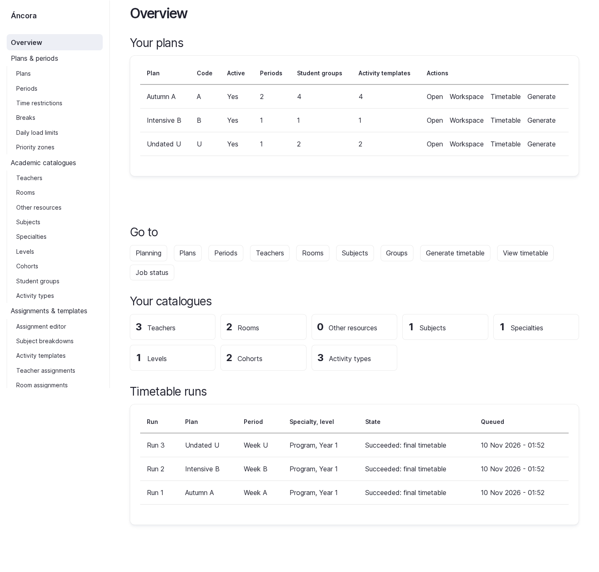
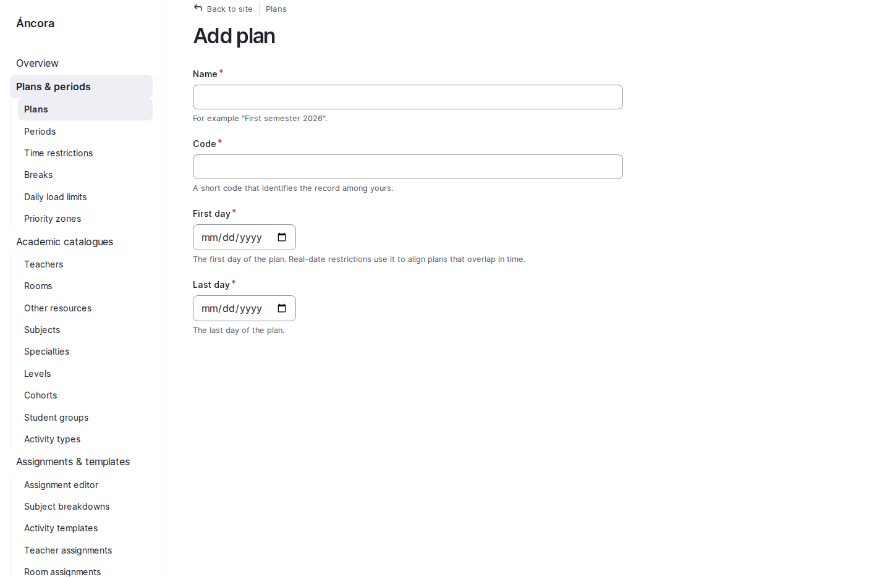
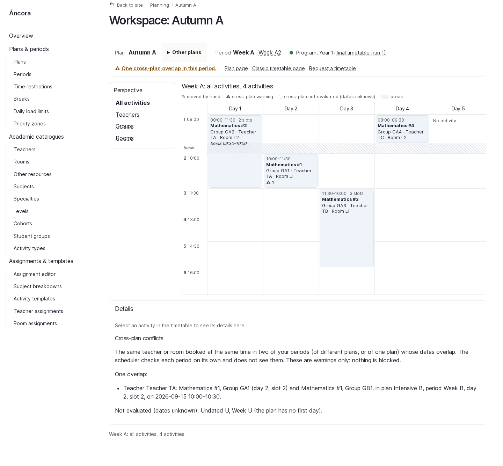
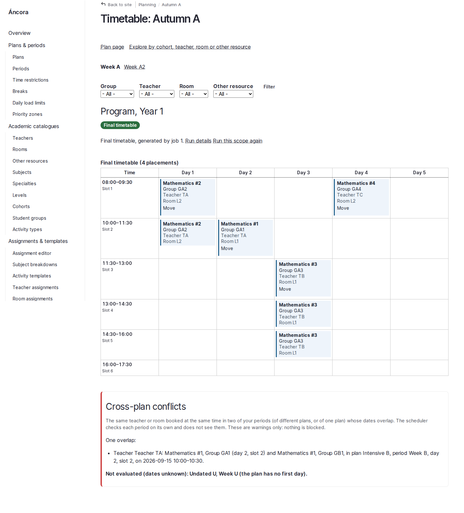

# Gin unified shell preview

Gin 5.0.16 (Drupal 11.2+) is the base theme for the shared `ancora_theme`, configured as both default and administration theme. The sidebar uses Drupal's access-checked main/admin menu blocks; Toolbar, Navigation and Gin Toolbar remain disabled to avoid competing navigation.

`ancora_theme` is a small Gin subtheme. Gin documents itself as an administration theme and does not officially support subtheming, so upgrades should recheck the inherited page/form templates. This integration uses Gin's existing regions, tokens and sticky form actions; no separate Gin Frontend dependency is used.

## Browser previews

| Overview | Add Plan |
|---|---|
|  |  |

| Planning Workspace | Timetable |
|---|---|
|  |  |
