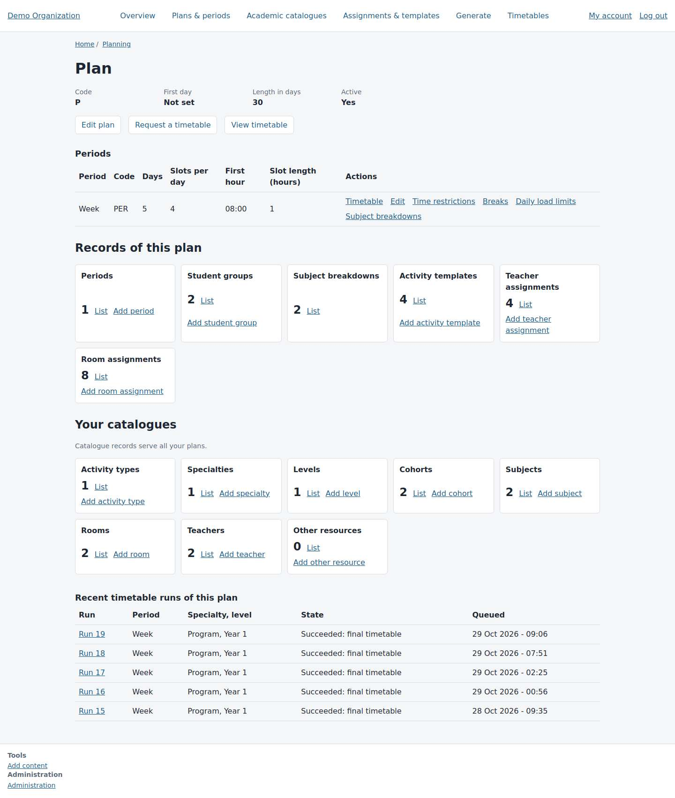
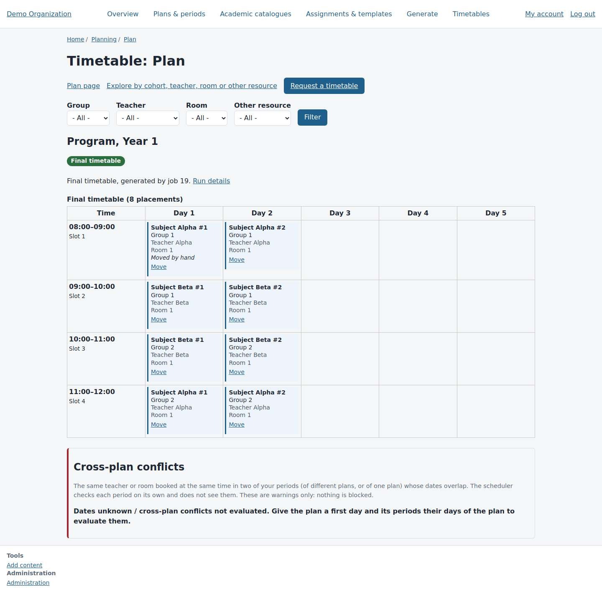
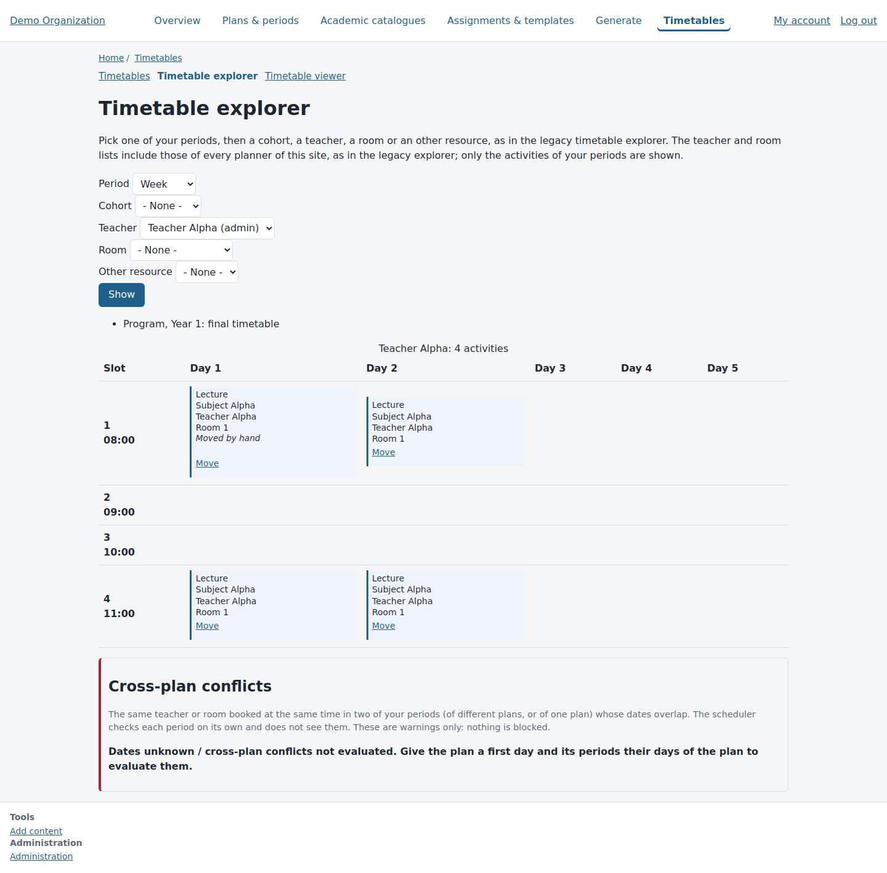
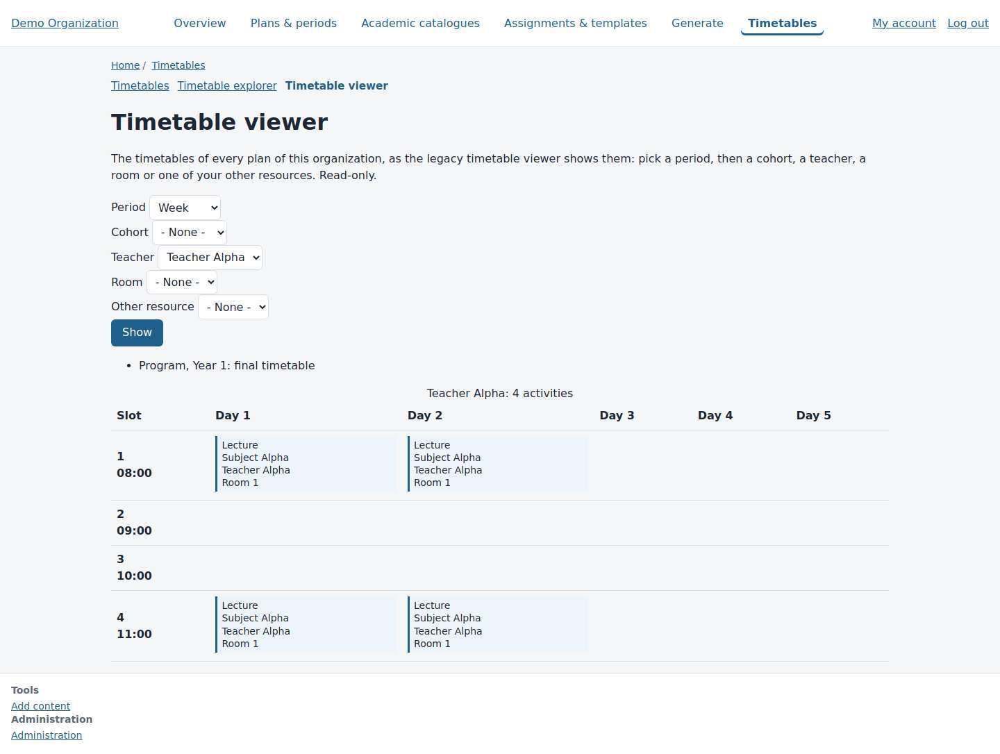
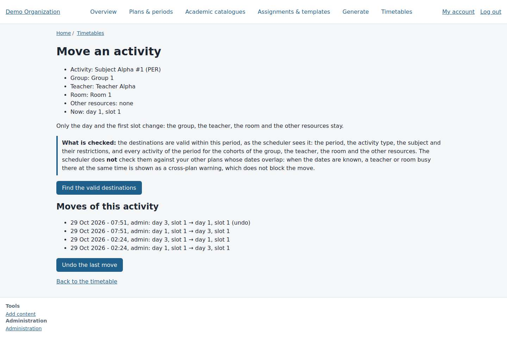
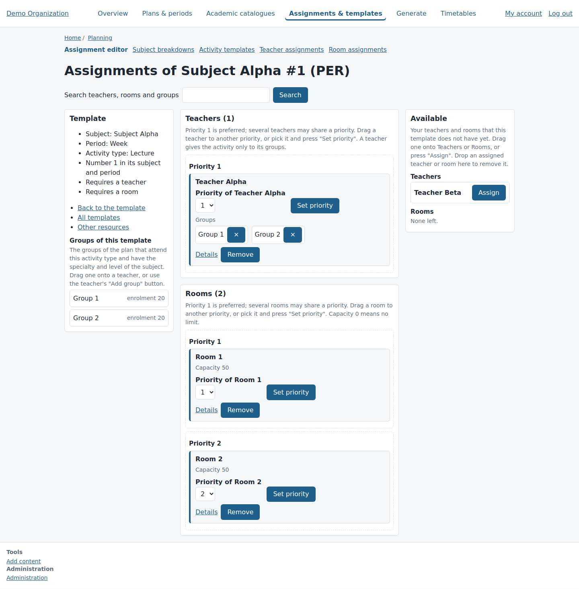
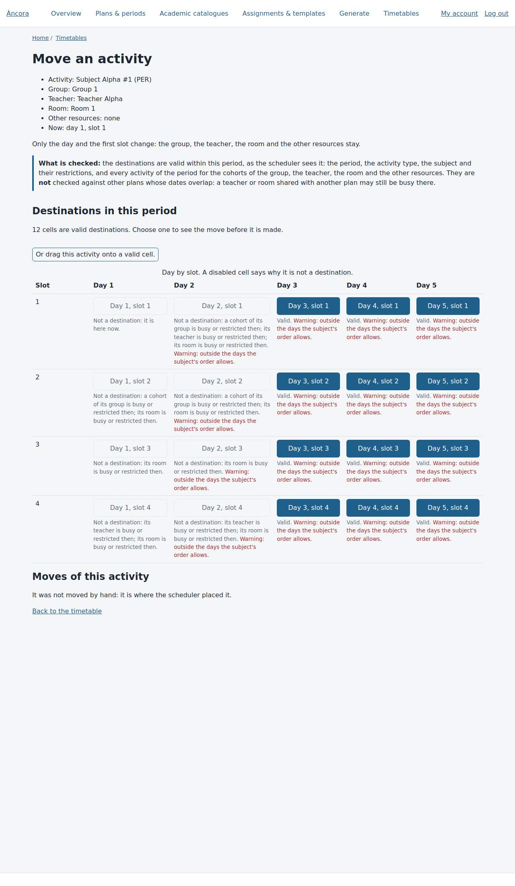
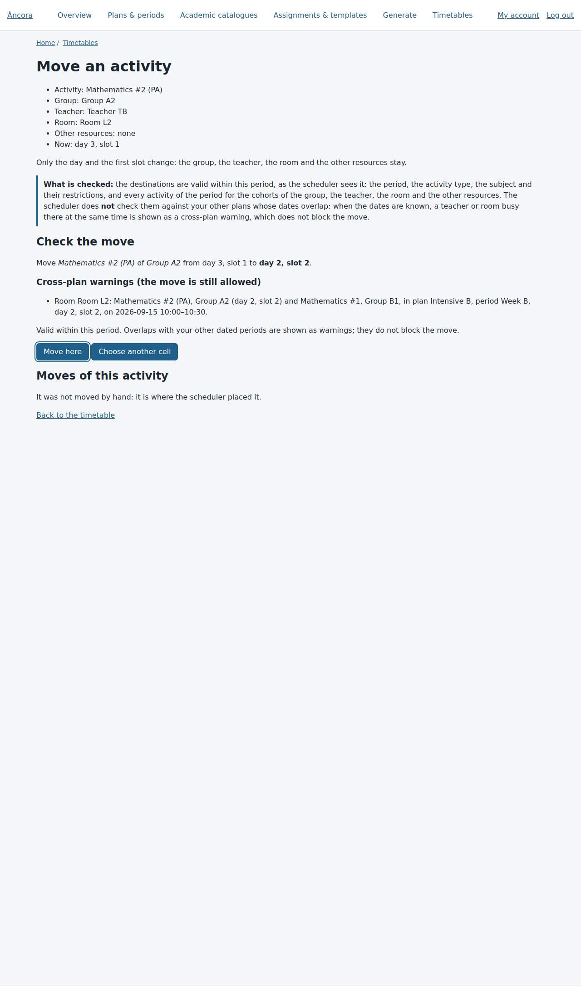
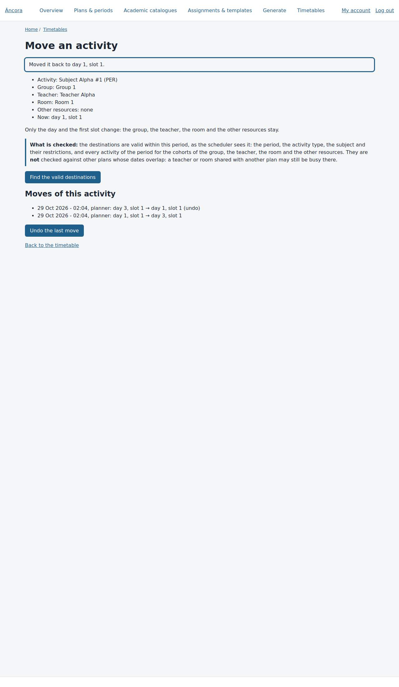

# Integrated planning workspace: audit, blueprint and frontend decision (#139)

**Status: design only.** This document proposes a design. Nothing here is authorized for implementation.
- Each slice in §5 needs the maintainer's approval first. The first slice is filed as a planned pilot issue.
- Where it differs from #66 or #74, it is written as a **proposed amendment** (§4.6), not an override.

**Parents and related issues**
- Parents: #74 (Drupal UI) and #66 (architecture).
- Related: #105 (planning journey), #122 (assignments), #123 / #130 (move), #133 (cross-plan warnings), and #136 / #138 (swap; #138 is **not authorized**).

**The rule this design keeps.** The legacy code is the specification for business rules. This document changes how the planner reaches those rules, not the rules themselves.
- No academic rule, generator behaviour or validation is redefined.
- Every write in this design goes through a command that already exists and is tested.

## Contents

1. [Method and safety of the evidence](#1-method-and-safety-of-the-evidence)
2. [Evidence audit](#2-evidence-audit)
3. [Target experience: IA and interaction blueprint](#3-target-experience-ia-and-interaction-blueprint)
4. [Frontend decision](#4-frontend-decision)
5. [Roadmap: vertical slices, dependencies, risks, acceptance](#5-roadmap)
6. [Open questions for the maintainer](#6-open-questions-for-the-maintainer)

---

## 1. Method and safety of the evidence

| Source | How it was read |
|---|---|
| VB6 desktop (`rafageist/ancora-vb6`) | Source read. Forms and the ribbon dispatcher were traced, and each fragment was classified as wired or unwired. |
| Thesis PHP application (this repo: `view/custom/*.tpl`, `view/wins/*`, `www/js/app/*`, `bin/security.conf`) | Source read. Templates, window registries, client calls and server event handlers were traced. |
| **Private Drupal demo** (`timetables.divengine.com/o/demo`, plan 1, period 1, workspace mode) | A real Chromium (Playwright) session, **read-only**. Details below. |
| Interactive states (move grid, preview, undo, warnings) | **Disposable** local sites with the #130 / #133 test fixtures. These captures are labelled *DISPOSABLE*. |

**How the demo session was kept read-only**
- The session logged in with a one-time admin link. On this site the link logs in on the GET itself.
- The browser context **aborted every non-GET request**. The result: 0 attempted and 0 blocked writes, and 0 POSTs, including the login.
- No form was submitted and no action button was pressed. "Find the valid destinations" was not pressed, and nothing was dragged.
- 18 pages returned 200, plus one section capture and one narrow-screen capture. The session ended by logging out.

**Recording**
- Each page's links, controls, words and height were recorded.
- Click distances are breadth-first shortest paths over the **captured link graph**, starting at `/ancora`.
- Gate credentials and login links are not recorded anywhere in this repository.

**Limit of the evidence: the demo is small.** It has one plan, one period, two groups, two teachers, two rooms and 8 placements.
- Density findings are therefore lower bounds.
- A real faculty period (6 days × 8–12 slots, dozens of groups) makes every issue in §2.4 worse, and none of them better.

---

## 2. Evidence audit

### 2.1 VB6 desktop: what was really wired

All references below are in `rafageist/ancora-vb6`, `frmKernelMain.frm` unless stated otherwise.

| Element | Evidence | Status |
|---|---|---|
| One main window (SDI) with a custom ribbon, `ACPRibbon`: 8 tabs and 46 buttons | `creaRibbon` :1196–1294; dispatcher `mainRibbon_ButtonClick` :897–1145 | Wired |
| **Left explorer tree** (`tvwScheduleExplorer`, :230) of plan, period, groups, teachers, rooms and resources | Click shows that object's timetable (:1463–1471). Double-click opens its editor (:1433–1452). Right-click opens a context menu (:692–723). | Wired: **the core interaction** |
| **Right panel: one timetable grid** (`frameCasillero`, :338) with brigade, teacher, room and resource perspectives | `mostrarHorario` :1931ff | Wired |
| Multi-slot activities drawn as spans | :2001, :2500–2511 | Wired |
| Subject colours | Random per subject (:2256–2266) | Wired. Colours are not stable between sessions. |
| Zoom (±20 px) | :854–868 | Wired |
| Restriction toggles by cell click | `goMPIIn` :2346–2410 | Wired |
| Activity popup on cell click (`frmDatosActividad`) | :2350–2362 | Wired |
| Hover tooltip on activities | grid handlers | Wired |
| **Swap by two right-clicks** | :824–833, :1302–1370 | Wired (characterized in #136) |
| Assignment window `frmDatosAsignacionRxAct` | Tree, lists, `>` `<` `^` `v`, *Clonar* (:312–419); no drag handler | Wired |
| Context | The selected tree node key (`keyfrmExplorerSchedule`, `modDataGlobals.bas`:62). `PeriodoActual` is private to the form (:814). | Wired, but **implicit** |
| Forms in the project | 55 `.frm` files: 41 in the `.vbp`, 14 unreferenced, about 28 reachable from the ribbon or tree. `frmExplorerAct` is referenced but missing. | Partly unwired |

**What VB6 got right**
- **One screen.** The tree on the left selects; the grid on the right shows. Every selection changes the grid **in place**.
- The planner never re-enters the period or the object.
- Details are popups over the grid, not page changes.

**What it got wrong**
- The context is invisible: there is no breadcrumb of plan or period.
- Colours are random.
- Restriction toggling and swapping are hidden in mouse gestures (right-clicks) with no keyboard path.
- Almost no accessibility.

### 2.2 Thesis PHP application: what was really wired

| Element | Evidence | Status |
|---|---|---|
| `view/custom/ribbon.tpl` (20 ribbon links) | Never included by any template or script (`git grep ribbon` finds only the file itself) | **Dead** |
| Real navigation: a **start-menu "desktop"** with 6 items filtered by permission, plus a taskbar | `view/custom/app.tpl`:142–195 (`start_menu` at :169) | Wired |
| **41 draggable modal windows**: 7 "browsers" (`view/wins/*.php`) and 34 forms | Registered in `app.tpl`:10–72; contents loaded by AJAX `app_event_*` handlers | Wired |
| Context | Per-browser JavaScript flags. It is not shared between windows. | Wired, **fragmented** |
| Known client defect | `refrescaDesgloseDetalle` (`www/js/app/client/browsers/ancoragoh_client_browsers_desgloses.js`) | Bug |
| Server events never called by the client | 272 of 417 `app_event_*` handlers are not posted by any client script | **Unwired** |
| Event permissions | Recovered `bin/security.conf` (deny by default) lists only 2 `event_permissions`, so about 147 events run only for `todos` holders | Restricts the UI to super-users |

**Patterns worth keeping**
- The **inline 1..N priority picker**, already reproduced in #122.
- **Inline delete confirmations** inside the panel, not a new page.
- **Up/down template order.**
- **Sliding detail panels** next to a list.

**What the PHP application got wrong**
- It recreated a Windows desktop in the browser: overlapping modal windows, no URLs, and no back button.
- Context was lost between windows.
- #66 rules this out explicitly ("no jQuery desktop"). That is correct and stays.

### 2.3 The current Drupal demo

The pages are server-rendered by Drupal (`ancora_theme`, Twig), with a horizontal main menu of six sections: Overview, Plans & periods, Academic catalogues, Assignments & templates, Generate and Timetables. Only two pages carry JavaScript:
- the assignment editor (`assignment-editor.js`, 183 lines);
- the move page (`placement-move.js`, 78 lines).

Both scripts are progressive enhancement over buttons (the #128 conventions). There is no Drupal AJAX (`#ajax`, `AjaxResponse`) and no JSON endpoint in the custom modules.

| Plan page | Plan timetable |
|---|---|
|  |  |
| The plan is a dashboard of record counts with "List" and "Add" links into entity admin pages. | One grid per specialty and level. Filters are a separate form. Each placement has a "Move" link to another page. The cross-plan section sits below the grid. |

| Explorer (by teacher) | Viewer (by teacher) |
|---|---|
|  |  |
| The legacy explorer, reproduced. The period and the object are picked again in a form. | The same data, read-only. It is a separate route, reached by a tab that drops the current selection. |

| Move page (opened only) | Assignment editor (#122) |
|---|---|
|  |  |
| A full page for one activity. The grid of destinations appears only after "Find the valid destinations" and a background check. | The most "application-like" screen today: three columns, with drag as a convenience over buttons. Its links lead to entity admin lists, not back to the plan or the timetable. |

| Interactive states (**DISPOSABLE** site, #130 fixtures) | | |
|---|---|---|
|  |  |  |
| The destination grid, with disabled cells that state their reasons. | The preview, with a #133 cross-plan warning. | The page after an undo. |

Other captures are in [`img/`](img/):
- [the request page](img/demo-11-request.jpg);
- [the run status](img/demo-13-job.jpg);
- [the explorer before a selection](img/demo-15-explorer.jpg);
- [the narrow screen (390 px)](img/demo-20-mobile-timetable.jpg).

**Measured pages (demo, 1440 px wide)**

| Page | Shortest clicks from `/ancora` | Path | Words | Links | Controls | Height (px) |
|---|---|---|---|---|---|---|
| Landing `/ancora` | 0 | — | 143 | 39 | 2 | 1210 |
| Planning overview | 1 | Planning | 232 | 64 | 0 | 2357 |
| Plan page | 1 | Open | 227 | 54 | 2 | 1702 |
| Period record `/admin/ancora/periods/1` | **not reachable by links**¹ | — | 40 | 9 | 1 | 900 |
| Catalogues section | 1 | Academic catalogues | 154 | 40 | 0 | 1607 |
| Assignment editor (one template) | 3 | Assignments & templates › Assignment editor › template | 243 | 24 | 15 | 1466 |
| Request a timetable | 1 | Generate | 210 | 38 | 10 | 1360 |
| Run status | 1 | Run 19 | 61 | 16 | 0 | 997 |
| Plan timetable | 2 | Open › Timetable | 243 | 34 | 5 | 1423 |
| Explorer (period only) | 3 | Open › Timetable › Explore… | 111 | 16 | 6 | 900 |
| Explorer / viewer for one teacher | **form selection only**² | — | 234 / 136 | 20 / 16 | 7 / 7 | 1419 / 1086 |
| Move page | 3 | Open › Timetable › Move | 201 | 14 | 2 | 960 |

¹ The plan page links each period's timetable, edit, restrictions, breaks, limits and breakdowns, but not the period record itself.
² The object is only reachable through a form submit (GET), never through a link that carries it.

### 2.4 Journey map: the planner's real tasks

Each **page load** is a full document request.

**T1. "Check teacher Alpha's week and move one of their activities, then undo."**

Counted from the captured links and from the move flow documented in `timetable-editing.md` §9. The demo move itself was not pressed.

| # | Today (demo) | Page loads | Context the user must re-enter |
|---|---|---|---|
| 1 | Landing › **Open** plan | 1 | — |
| 2 | **Timetable** | 1 | period (implicit `?period=1`) |
| 3 | Pick teacher in the filter › **Filter** | 1 | **teacher** |
| 4 | **Move** on one activity | 1 | — (teacher filter now gone from the URL) |
| 5 | **Find the valid destinations** (POST) | 1 | — |
| 6 | Wait for the check: automatic reloads every 2 s (≥ 1) | ≥ 1 | — |
| 7 | Pick a cell (preview) | 1 | — |
| 8 | **Move here** | 1 | — |
| 9 | **Undo the last move**: a new check, its reloads, then confirm | ≥ 3 | — |
| 10 | **Back to the timetable**: returns to `?period=1`, the teacher filter is lost | 1 | — |
| 11 | Pick the teacher again › **Filter** | 1 | **teacher, again** |
| | **Total** | **≥ 13 page loads, 2 re-entries** | The selected activity is never highlighted when the user comes back. |

**T2. "See the same activity from the room's and the group's point of view."**
- Today there are two routes. The plan timetable filter (four selects) or the explorer and viewer each need 1 form submit per perspective.
- The explorer link from the timetable carries only `period`, so any filter is dropped.
- The "Timetable explorer" ↔ "Timetable viewer" tabs carry **no** query, so period and object are both dropped (`/ancora/timetables/viewer` with no query).
- Result: **≥ 2 page loads and ≥ 2 re-entries per perspective switch.**

**T3. "Fix why an activity has no room, then regenerate."**
- Plan › Assignments & templates › Assignment editor › template: 3 page loads.
- Set a priority or assign a room: 1 POST page load each.
- **Generate**: 1 page load. That page shows the plan selector again, and the scope must be picked again: specialty, level and period.
- Submit, then the run page. It does not refresh itself: the user reloads it by hand until the run is done.
- Run › "Timetable of this plan" (1). Re-filter (1).
- The assignment editor has **no link back to the plan, the period's timetable or the request**. Its links lead to five entity admin lists.
- Result: **≥ 9 page loads and 3 context re-entries** (plan, scope, filter).

**T4. "Are there cross-plan conflicts?"**
- The #133 section is at the bottom of every timetable page, below the grid, with the same height whether it has 0 or n warnings.
- When dates are unknown it says so (correct: unknown never means "no conflict"). The warning does not link to the activity it concerns.

**Summary of what is lost**

| State | Where it is lost |
|---|---|
| Selected object (teacher, room, group) | The timetable's Move link, the move page's "Back to the timetable", the explorer ↔ viewer tabs, the timetable's "Explore…" link |
| Selected activity | Every return to a grid: no highlight and no scroll position |
| Plan and period | Assignment editor, request page and entity admin lists: the shell has **no persistent context bar** |
| Generation scope | Request page: picked again on every run |

**Density and other confusing interactions**

*Page layout*
- The grid shows 4–5 text lines per placement: subject, group, teacher, room and "Move", with no colour by subject or activity type.
- The demo's 8 placements already need 1423 px.
- The cross-plan section and the filters compete with the grid for the first screen.

*Navigation*
- Three entry points show the same timetable data with different controls: the plan timetable, the explorer and the viewer.
- The request page shows 38 links, 22 of them Drupal administration links (entity lists, Structure, Appearance, Extend, Configuration, People, Reports).
- The Drupal "Tools / Administration" block sits under every page.

*Narrow screens*
- At 390 px the timetable becomes a day-by-day list with no horizontal overflow (good, measured overflow 0).
- The list has no day switcher and no "now" anchor, so the user scrolls through every day.

*Move and undo*
- The move flow is correct and accessible, but **it is a separate page per activity**.
- The destination check is a background job: the wait shows as automatic page reloads.
- Undo is offered only on that activity's move page, not where the user saw the result.

### 2.5 Gap matrix: historic vs current

| Capability | VB6 (2010) | PHP thesis | Drupal demo today | Gap to close |
|---|---|---|---|---|
| Persistent plan/period context | Implicit (tree selection) | Per window, lost | **None** (only in some URLs) | A visible, persistent context bar, stored in the URL |
| Explore objects without leaving the grid | **Yes** (tree → grid in place) | Separate windows | No (forms, separate routes) | An object list or lens switch that updates the grid in place |
| Perspectives (group / teacher / room / resource) | Yes, one grid | Explorer window | Yes, but across 3 routes | One canvas, a lens switch, and the URL kept |
| Multi-slot spans | Yes (drawn across slots) | Yes | Partly: the card is repeated in every slot it occupies (with "Move" only in the first); there is no visual span | Draw one card across the slots it occupies |
| Activity detail without navigation | Popup | Modal window | No (Move page only) | Inspector drawer |
| Move with validation | Partial (manual edit) | Not wired | **Yes, server-validated (#130)**, separate page | The same command, in place |
| Undo | No | No | **Yes (#130)**, on the move page | Undo in the toast and the inspector |
| Swap | Two right-clicks | No | Designed (#136); #138 on hold | In the inspector, once authorized |
| Cross-plan warnings | No | No | **Yes (#133)**, at the bottom | Badges on cells plus an inspector panel |
| Assignment priorities | Window with ^ v | Inline picker | **Yes (#122)**, separate page | Inspector tab for the template |
| Restriction toggles | Click on cell (hidden gesture) | Forms | Grid form (separate page) | Later slice: a "restrictions" lens on the same canvas |
| Generation status | Modal | Modal | Run page, reloaded by hand | A run drawer with a status that updates by itself |
| Keyboard and screen reader | Poor | Poor | **Good** (buttons first) | Keep as a hard requirement |
| Mobile | n/a | n/a | Usable list | A day agenda with a day switcher |
| Permissions and security | Weak | Deny by default, 2 rules | **Strong** (access checks, CSRF, owner checks) | **Must not regress** |

---

## 3. Target experience: IA and interaction blueprint

### 3.1 Principles

1. **The server stays the authority.**
   - Every validity question is answered by an existing domain service: `PlacementModification`, `CrossPlanConflictDetector`, the case-150 SQL functions, and the assignment services of #122.
   - JavaScript **never** decides validity. It only shows what the server returned.
2. **The URL is the state.** Plan, period, lens, object and selected activity live in the query, so reload, back, bookmarks and shared links restore the screen exactly.
3. **Buttons first, enhancement second (#128 conventions).**
   - Every action is a real link or a form button that works without JavaScript, with a full page load.
   - With JavaScript the same request returns a partial and the page is updated in place.
   - Drag remains a shortcut that presses the same button.
4. **One canvas.** The plan timetable, the explorer and the viewer become **lenses** of one workspace. The existing routes stay as fallbacks and permalinks.
5. **Context is visible.** A context bar is always on screen. It is never re-entered after a write.

### 3.2 Information architecture

```
Áncora (shell)
├─ Plans (list, create)                        ← entry; "recent plans" first
└─ Plan workspace  /ancora/planning/{plan}/workspace?period=&lens=&obj=&sel=
   ├─ Context bar: Plan ▾ · Period ▾ · Scope (specialty/level) ▾ · state badge · Run ▸
   ├─ Left rail (collapsible): Groups · Teachers · Rooms · Resources · Templates (search)
   ├─ Canvas: timetable grid (lens = group | teacher | room | resource | all)
   ├─ Inspector drawer (right; off-canvas on narrow): Activity · Object · Template · Run
   └─ Secondary pages (unchanged routes, opened from the workspace):
      catalogues CRUD, period inputs (breaks, limits, restrictions), entity admin
```

**Query parameters**

| Parameter | Meaning |
|---|---|
| `period` | the period |
| `lens` | `group`, `teacher`, `room`, `resource` or `all` |
| `obj` | the object's id in that lens |
| `sel` | the placement id |
| `panel` | `activity`, `object`, `template` or `run` |

Each parameter is validated server-side against the user's access, exactly as the explorer validates its query today. An invalid value falls back to the default, never to another tenant's data.

### 3.3 Wireframes

**W1. Desktop workspace, teacher lens, activity selected (≥ 1200 px)**

```
┌──────────────────────────────────────────────────────────────────────────────────────────┐
│ Áncora   Plans   Catalogues   Runs                                   admin ▾   Log out    │ ① shell
├──────────────────────────────────────────────────────────────────────────────────────────┤
│ Plan: Plan P ▾ │ Period: Week ▾ │ Program · Year 1 ▾ │ ● Final timetable (run 19) │ ▶ Generate │ ② context bar
├───────────────┬─────────────────────────────────────────────────────┬────────────────────┤
│ Lens          │ Teacher Alpha · 4 activities          ⚠ 0  ◷ 1 moved │ Activity           │
│ (•)Teacher    │ ┌──────┬──────────┬──────────┬───────┬───────┬──────┐ │ Subject Alpha #1   │ ⑤ inspector
│ ( )Group      │ │      │ Day 1    │ Day 2    │ Day 3 │ Day 4 │ Day 5│ │ Group 1 · Room 1   │
│ ( )Room       │ ├──────┼──────────┼──────────┼───────┼───────┼──────┤ │ Teacher Alpha      │
│ ( )Resource   │ │08:00 │▌Alpha #1 │▌Alpha #2 │       │       │      │ │ Day 1, slot 1      │
│ [search…   ]  │ │      │ G1 · R1  │ G1 · R1  │       │       │      │ │ ✎ moved by hand    │
│ Teachers      │ │      │ ✎        │          │       │       │      │ │────────────────────│
│ ▸ Teacher Alpha│ ├──────┼──────────┼──────────┼───────┼───────┼──────┤ │ [Move…] [Swap…]⑦   │
│   Teacher Beta│ │09:00 │          │          │       │       │      │ │ [Undo last move]   │
│               │ │ ...  │          │          │       │       │      │ │ History (4) ▸      │
│ ③ rail        │ │11:00 │▌Alpha #1 │▌Alpha #2 │       │       │      │ │ Cross-plan: dates  │
│               │ │      │ G2 · R1  │ G2 · R1  │       │       │      │ │ unknown ⓘ          │
│               │ └──────┴──────────┴──────────┴───────┴───────┴──────┘ │ Template ▸ (#122)   │
│               │ ④ canvas: cells are buttons; ▌= subject colour token    │                    │
├───────────────┴─────────────────────────────────────────────────────┴────────────────────┤
│ ⑥ status region (role=status): "Moved Subject Alpha #1 to day 3, slot 1.  [Undo]"         │
└──────────────────────────────────────────────────────────────────────────────────────────┘
```

Annotations:
- ① **Shell.** Three top-level destinations instead of six admin sections. Catalogues stays a section, because its records serve all plans.
- ② **Context bar.**
  - It is sticky.
  - Changing the plan or period replaces the canvas in place and pushes the URL.
  - The state badge shows the publication state from the existing read model: final, partial, failed, or "stale since input changed".
  - "Generate" opens the run drawer (W4) prefilled with the current scope.
- ③ **Rail.**
  - It lists the user's objects for the lens, using the explorer's existing access rules.
  - Picking an object is a link (`?lens=teacher&obj=1`), enhanced to replace the canvas only.
  - Search filters the list client-side; it is only a display filter.
- ④ **Canvas.**
  - It is the existing timetable grid, rendered by `TimetableReader` and `TimetableExplorer`, as an SDC component.
  - Each placement is a button (`aria-pressed` for the selection). A multi-slot activity spans the slots it occupies as one card (`rowspan`), instead of a card repeated in every slot.
  - A colour token per subject is stable across sessions, derived from the subject id, with a legend.
  - Markers: ✎ moved by hand; ⚠ cross-plan warning (n). The selected cell is outlined and scrolled into view.
- ⑤ **Inspector.**
  - It is Drupal core's off-canvas dialog (`drupal.dialog.off_canvas`), or a server-rendered aside when JavaScript is off.
  - It shows the selected activity, its history (the existing `ancora_placement_change` list) and its warnings.
  - It holds the actions the user may take.
- ⑥ **Status region.** Every server write reports here (`role=status`, or `role=alert` for refusals), with Undo where the domain allows it (only the last change, §9 of `timetable-editing.md`).
- ⑦ **Swap** is shown only when #138 is authorized and implemented. Until then it is absent, not disabled.

**W2. Move in place (the #130 flow without leaving the workspace)**

```
 Inspector: Activity › Move                       Canvas (same grid, "move mode")
┌──────────────────────────────┐   ┌──────┬───────────┬───────────┬───────────┐
│ Move Subject Alpha #1        │   │      │ Day 1     │ Day 2     │ Day 3     │
│ Only day and slot change.    │   │08:00 │ ▣ current │ ✕ teacher │ ◯ valid   │
│ What is checked ⓘ            │   │      │           │   busy    │           │
│ ◷ Checking destinations…     │   │09:00 │ ◯ valid   │ ✕ group   │ ◯ valid   │
│   (aria-busy; Cancel)        │   │      │           │   busy    │ ⚠ 1 cross │
│ ── when done ──              │   └──────┴───────────┴───────────┴───────────┘
│ 9 valid cells. Pick one on   │   ◯ = button "Move to day 3, slot 1"
│ the grid or in this list:    │   ✕ = disabled, reason in aria-describedby
│  • Day 1 slot 2              │   ⚠ = valid with cross-plan warning (#133)
│  • Day 3 slot 1  ⚠ 1        │
│ [Preview] → "Move here"      │   Drag ▣ onto ◯ = press that button
└──────────────────────────────┘
```

1. "Move…" requests a check (`requestCheck`, unchanged).
2. The inspector shows the busy state. Its AJAX poll **replaces only the inspector and canvas overlay**, not the page: same interval, same 30-try limit.
3. When the check is done, the server renders the same destination grid that `PlacementMoveForm` renders today, as an overlay of the canvas, plus the list alternative.
4. Preview and commit post the **same form** (`PlacementMoveForm`, same form token, same `commit()` refusals).
5. On success the canvas and inspector are re-rendered, the moved cell is selected, and the status region offers Undo.
6. Without JavaScript the "Move…" link opens today's move page, unchanged.

**W3. Cross-plan warnings in place (#133)**

```
 Context bar: … │ ⚠ 2 cross-plan │   ← count, links to ?panel=conflicts
 Cell:  ▌Alpha #2  ⚠              ← badge on each placement that has a warning
 Inspector › Conflicts:
   Room L2 · Day 2 slot 2 · 2026-09-15 10:00–10:30
   also used by Mathematics #1, Group B1 — plan Intensive B, period Week B   [Open there ↗]
   "Warning only: the scheduler checks each period on its own."
 When dates are unknown: one neutral notice in the bar ("Cross-plan: not evaluated — set dates ↗"),
 never a green "no conflicts".
```

**W4. Run drawer (generation status without leaving)**

```
 ▶ Generate → Inspector › Run
   Scope: Program · Year 1 · Week (from the context bar; editable)   [Request a timetable]
   Run 20 · queued → running → ✓ final timetable (8/8 placed, 0 collisions)
   [Show the new timetable]  ← replaces the canvas; the lens and object are kept
```

The request is the existing `RequestRunForm` with the same validation. The status is a partial of the existing run page, polled with a bounded interval.

**W5. Template assignments in the inspector (#122)**

```
 Inspector › Template "Subject Alpha #1 (PER)"
   Teachers   P1: Teacher Alpha [Groups: G1 ×  G2 ×] [Priority ▾] [Remove]
   Rooms      P1: Room 1   P2: Room 2
   Available  Teacher Beta [Assign]
   (the same AssignmentEditorForm, rendered narrow; drag stays a shortcut)
   ⓘ Changes apply to the next run; the state badge turns "stale".
```

**W6. Narrow screens (< 768 px)**

```
┌──────────────────────────────┐
│ ☰  Plan P · Week ▾      ⚠ 0  │ context collapses to one line; tap opens the bar as a sheet
│ Lens: Teacher Alpha ▾        │
│ ◀ Day 2 ▶   (Mon … Fri tabs) │ day switcher instead of a 5-column grid
├──────────────────────────────┤
│ 08:00 ▌Subject Alpha #2      │ one row per slot; spans show "08:00–10:00"
│       G1 · Room 1        ⋯   │ ⋯ opens the inspector as a bottom sheet
│ 09:00 — free —               │
│ 11:00 ▌Subject Alpha #2   ⚠  │
└──────────────────────────────┘
 Move on narrow screens: inspector › Move › list of valid cells (no grid, no drag).
```

### 3.4 States

| State | Treatment |
|---|---|
| Loading a partial | `aria-busy` on the region being replaced. The old content stays visible, dimmed, so nothing jumps. |
| Destination check queued or running | Inspector busy state with a Cancel link. Bounded polling. The time waited is shown. |
| Generation queued or running | Context-bar badge "Run 20 running". Moves are refused by the server (`job`), and the UI says why **before** the user starts. |
| Stale input | Badge "Inputs changed since run 19". Moves stay possible, as today. |
| Version conflict (another user moved it) | The server's `version` or `placement` refusal is shown in an alert. The canvas is re-rendered from the server. |
| Empty | No plan, no period, no run, or no placements. Each gets one sentence and the one next action. |
| Error, 403 or 404 on a partial | An alert in the region, plus a link to the full page fallback. The session is never left blank. |
| Offline or no JavaScript | Every action works with full page loads (today's routes). |

### 3.5 Keyboard and accessibility (hard requirements)

**The canvas**
- The canvas is a grid with **roving tabindex**: arrows move between cells, Enter selects, and `m` opens Move for the selected activity. Every shortcut is listed and optional.
- Every action is reachable by Tab through real buttons. No action needs a pointer, a right-click or a hover.

**The inspector**
- It is a labelled dialog region. Esc closes it and returns focus to the selected cell.

**Feedback and focus**
- All feedback goes to `role=status` or `role=alert`.
- After every in-place update, focus moves to a defined target: the moved cell, or the error.

**Visual rules**
- Colour is never the only signal. Markers have text and `aria-label`.
- Subject colour tokens meet a contrast ratio of at least 3:1 against the cell, and text keeps 4.5:1.

### 3.6 Before / after workflows

| Task | Today | Target (with JS) | Without JS (target) |
|---|---|---|---|
| T1 Check teacher, move, undo | ≥ 13 page loads, 2 re-entries | **1 page load** (workspace), then in-place partials. About 6 user actions: lens, teacher, cell, Move, destination, Undo. 0 re-entries. | Same as today, but the move page's "Back" returns to the workspace URL **with** lens, object and selection. |
| T2 Switch perspective | ≥ 2 page loads and re-entries per switch | 0 page loads, 1 action (lens and object). The selection is kept when it is visible in the new lens. | 1 page load, no re-entry |
| T3 Fix assignment, regenerate | ≥ 9 page loads, 3 re-entries | 1 page load. Inspector › Template, then Run drawer prefilled. 0 re-entries. | Links between editor, request and workspace carry context |
| T4 Cross-plan conflicts | Scroll to the bottom; no link to the activity | Badge in the bar, ⚠ on cells, and inspector detail with "Open there" | Section kept, with anchors to cells |

### 3.7 Component inventory

| Component | Kind | Built from | Notes |
|---|---|---|---|
| `app-shell` | Theme `page.html.twig` | Existing theme | 3 destinations; admin links only for admins |
| `context-bar` | SDC + small behavior | Plan, period and scope pickers (links or GET form) | Sticky; GET fallback |
| `object-rail` | SDC | Explorer's object lists | Links; client-side text filter |
| `lens-switch` | SDC | Radios in a GET form | Enhanced to update in place |
| `timetable-canvas` | SDC (Twig) | `TimetableReader` / `TimetableExplorer` render arrays | Cells as buttons, spans, markers, legend |
| `placement-card` | SDC | Existing placement markup | Subject token, ✎ and ⚠ markers |
| `inspector` | Core off-canvas dialog / aside | Drupal `drupal.dialog.off_canvas` | Tabs: Activity, Conflicts, Template, Run |
| `move-panel` | Existing form | `PlacementMoveForm` (unchanged contract) | AJAX-wrapped; full page fallback stays |
| `destination-overlay` | SDC | The move form's grid | Same buttons, rendered over the canvas |
| `history-list` | Existing render | `ancora_placement_change` | — |
| `conflict-list` | Existing render | `CrossPlanConflictView` | Adds per-cell anchors |
| `assignment-panel` | Existing form | `AssignmentEditorForm` (#122) | Narrow layout variant |
| `run-panel` | Existing form and page | `RequestRunForm` + run status | Bounded polling |
| `status-region` | Behavior | `Drupal.announce` + a visible toast | Undo button where allowed |
| `ancora-workspace` behavior | One Drupal behavior library | `core/drupal`, `core/once`, `core/drupal.ajax` | URL sync, focus management, roving tabindex |

---

## 4. Frontend decision

### 4.1 What the UX actually needs from the client

1. Replace one region (canvas, inspector, bar) after a server response, without a page load.
2. Keep the URL in sync, so back and reload work.
3. Manage focus and keyboard in a grid.
4. Poll a bounded background check or run.
5. Drag as a shortcut that presses a button.

**None of these needs a client-side model of the timetable.** The server already renders the grid and is the only authority on validity. This is the deciding fact for the matrix below.

### 4.2 Options

| Criterion | A. Twig/SDC + behaviors (status quo) | **B. A + Drupal AJAX partials (HTMX-style), progressive** | C. B + one Web Component for the canvas | D. React/Vue/Preact island for the canvas | E. SPA |
|---|---|---|---|---|---|
| Fixes page loads and context loss | No (still full pages) | **Yes** | Yes | Yes | Yes |
| Accessibility | Good (buttons first) | **Good**: same markup; focus management needed | Good if light DOM; shadow DOM complicates labels and forms | Depends on the team; rebuilds accessible markup in JS | Same as D, everywhere |
| Drupal render, cache and permissions | Native | **Native**: partials are render arrays with the same access checks and cache contexts | Native (server HTML inside the element) | Needs JSON endpoints, plus duplicated cache and access reasoning | Needs a full API layer |
| CSRF and forms | Native form tokens | **Native**: the same `FormBase` forms over `#ajax`; tokens unchanged | Native | Custom token handling for every action | Custom everywhere |
| JSON/action API needed | No | **No** (HTML partials) | No | **Yes**: read model and commands | Yes, complete |
| Domain logic duplication risk | None | **None** | Low | Medium: validity tempted into JS | High |
| Bundle, build and deploy | None | **None** (core libraries) | None (one ES module, no build) | npm build, lockfile, CI step, bundle on the droplet | Same, plus routing and auth |
| Tests | PHPUnit Functional | **Functional + FunctionalJavascript + Playwright E2E** | Same, plus element unit tests | Plus JS unit tests and API contract tests | Everything twice |
| Responsiveness on a 1 vCPU host | Full page per action | **Small HTML fragments** | Same | JSON plus client render | Same as D |
| Fits #66 / #74 | Yes | **Yes, with amendment A1** (§4.6) | Yes, with A1 | Needs A1 + A2 | Contradicts #66 |
| Effort for slice 1 | — | **Medium** | Medium+ | High | Very high |

**Notes on the options**
- **HTMX itself.** It would be a new third-party dependency doing what `core/drupal.ajax` already does: `use-ajax` links, `#ajax` on form elements, and `AjaxResponse` with `ReplaceCommand`, `HtmlCommand`, `InvokeCommand` and custom commands. B uses Drupal's own mechanism, so CSRF, the form cache, attachments (`#attached` libraries) and `drupalSettings` keep working.
- **What core AJAX lacks.** It does not update the URL. That gap is closed by one small custom AJAX command, `ancoraUrl`, that calls `history.replaceState` or `history.pushState` with a server-computed URL, plus a `popstate` handler that re-requests the region.

### 4.3 Recommendation

**Option B: Twig/SDC components, Drupal behaviors, and Drupal AJAX partials, with strict progressive enhancement.** Keep C (a light-DOM Web Component for the canvas keyboard grid) as an **optional refinement inside B**, adopted only if the behavior becomes unwieldy.

**Rejected for now**
- D (a React, Vue or Preact island) and E (a SPA). They would require a JSON command layer, a build pipeline and client-side state. None of the measured problems requires them, and they would invite validity logic into JS.

**Revisit trigger for D**, recorded here so the decision is falsifiable. Revisit only if one of these is measured on a real fixture:
- a lens switch partial exceeds 500 ms p95 server-side at realistic size (≥ 40 groups × 6 days × 10 slots);
- a needed interaction cannot be expressed as "server returns HTML for a region", such as continuous client-side what-if editing of many cells before a commit.

### 4.4 Reusable contracts (no domain rewrite)

| Contract | Exists today | Used by the workspace as |
|---|---|---|
| `TimetableReader` / `TimetableExplorer` read model | Yes | Canvas render for every lens |
| `PlacementModification::requestCheck / check / commit / undo` | Yes (#130) | Move and undo panel. **Same methods, same refusals.** |
| `PlacementMoveForm` (`FormBase`) | Yes | Wrapped with `#ajax`; its submit handlers do not change |
| `CrossPlanConflictDetector` / `CrossPlanConflictView` | Yes (#133) | Bar count, cell badges, inspector list |
| `AssignmentEditorForm` and its services | Yes (#122) | Inspector › Template |
| `RequestRunForm` + job status | Yes | Run drawer |
| Placement swap command | **Designed only (#136); #138 not authorized** | Inspector action, added only when #138 lands |
| New: workspace route + region partial routes | No | Thin controllers that **only compose** the above render arrays. Same access checks as the routes they wrap. |

**How each feature migrates**
- **#130 move/undo.**
  - No change to `PlacementModification`, the check runner, the worker or the tables.
  - The form gains an AJAX wrapper and a `destination` parameter so that "Back" and success return to the workspace URL. The check-pending reload becomes an AJAX poll of the inspector region.
  - Kernel and functional tests stay as they are. FunctionalJavascript tests are added for the in-place path.
- **#133 warnings.** No change to the detector. Its output is rendered in three places instead of one, and the "unknown" semantics stay ("not evaluated", never "none").
- **#122 assignments.** No change to the form's actions or services. A narrow template variant is used in the inspector, and the drag shortcut stays a button press.
- **#138 swap (when authorized).** Its command follows the #136 design. The workspace gets an inspector action and a second selection mode on the canvas. No other workspace change is needed. **Nothing in this document authorizes #138.**

### 4.5 Security, cache and permissions rules for the workspace

- **Writes**
  - Every write stays a Drupal form submit with its form token. There are no new write endpoints.
  - Partial endpoints are **GET, read-only**.
- **Access**
  - Partial routes declare the same `_permission`, `_custom_access` and entity access as the pages they compose.
  - A partial never returns data that the full page would not show to that user.
  - The `obj`, `sel` and `period` query values are validated against ownership, as the explorer does today. Forged ids get 403 or 404, which is tested.
- **Cache metadata**
  - Partials carry the cache metadata of their render arrays: `user`, `url.query_args:<name>`, and the placement, plan and period cache tags.
  - The workspace page varies by `url.query_args`.
- **Escaping.** No `innerHTML` with client-built strings. The client only inserts server-rendered HTML through Drupal AJAX commands.
- **Logging.** No academic data is written to the browser console or to `drupalSettings` beyond the ids already in the URL.

### 4.6 Proposed amendments to #66 / #74 (for the maintainer's decision)

| # | Current text | Proposed amendment | Why |
|---|---|---|---|
| A1 | #66 §4 and #74: "only limited JavaScript for highly interactive scheduling" and "JavaScript … only for interactive schedule grid and necessary dynamic controls" | Allow **one workspace behavior library**, plus Drupal AJAX partials across the planning workspace (shell, context bar, rail, inspector, canvas). It is bounded: no build step, no npm runtime dependency, first-party JavaScript at most 25 KB minified and gzipped, and progressive enhancement mandatory. | Context loss happens *between* pages, not only inside the grid. Fixing it requires in-place updates of the shell regions. |
| A2 | #74: "Use Drupal admin/menu, Views…" as the UI frame | The **planner's primary frame is the plan workspace**. Drupal admin pages and Views remain for catalogue CRUD and administrators, linked from the workspace and returning to it. | The audit shows the admin-first frame causes the re-entries. #105 already asks for this. |
| A3 | Implicit in #66: no client framework | Unchanged for now: **no SPA, no React/Vue island.** Record the revisit trigger of §4.3 so that a later decision is evidence-based. | Prevents a framework by default, without forbidding one forever. |
| A4 | (new) | Use Drupal core's off-canvas dialog for the inspector. Use no contrib UI framework unless separately justified. | Keeps the dependency surface at core. |

---

## 5. Roadmap

### 5.1 Vertical slices (each one ships on its own)

| Slice | Content | Depends on | Ships value alone? |
|---|---|---|---|
| **S1: Pilot: plan workspace + in-place move/undo** | Workspace route. Context bar (plan, period). Lens switch and object rail (teacher, group, room). Canvas from the existing read model. Inspector for one activity (detail, history, cross-plan list). **#130 move/undo in place.** Status region with Undo. Full page fallbacks. A journey E2E test measuring page loads. | #130, #133 (both deployed) | Yes: T1 and T2 end to end |
| S2: Lenses for all objects; retire duplicate entries | Resource lens. Explorer and viewer routes redirect to the workspace lens (kept as permalinks). The timetable's "Explore…" link goes away. The `all` lens replaces the plan timetable page. | S1 | Yes |
| S3: Cross-plan in place, complete | Bar count, cell badges, "Open there" links into the other plan's workspace | S1 | Yes |
| S4: Template assignments in the inspector | #122 form in the inspector, with "stale" feedback in the bar | S1, #122 | Yes: T3 part 1 |
| S5: Run drawer | Request and status in the inspector, scope prefilled, "Show the new timetable" keeps the lens | S1 | Yes: T3 part 2 |
| S6: Narrow-screen agenda | Day switcher, bottom-sheet inspector, list-based move | S1 | Yes |
| S7: Period inputs on the canvas | Restrictions and breaks as a lens on the same grid, replacing the separate restriction grid page (the legacy `goMPIIn` affordance) | S1, S2 | Yes |
| S8: Swap in place | Inspector action and two-selection mode | **#138 authorized and merged**, S1 | Yes |
| S9: Visual system | Subject colour tokens, density modes (compact/comfortable), print and export view, SDC library documentation | S1 (can run alongside S2–S6) | Yes |

### 5.2 Dependency and risk matrix

| Risk | Slice | Likelihood | Impact | Mitigation |
|---|---|---|---|---|
| AJAX path diverges from the no-JS path (two behaviours) | S1+ | Medium | High | One form, one submit handler. Tests run both paths (Functional + FunctionalJavascript) for every write. |
| Cache leaks across users or tenants in partials | S1+ | Low | **Critical** | Cache contexts `user` and `url.query_args`, plus tags. A two-user test of the same partial URL. Run the multisite tenant E2E (#75). |
| URL state accepts forged ids | S1 | Medium | High | Server-side validation as in the explorer. 403/404 tests for every parameter. |
| Polling load on the 1 vCPU host | S1, S5 | Medium | Medium | The existing bounded poll (2 s, at most 30 tries). Only the small region is returned. Backoff on the run drawer. |
| Destination check latency feels broken in place | S1 | Medium | Medium | Visible busy state with the time waited and a Cancel link. The latency comes from the worker cycle. Measure it, and document it if it exceeds a target (an open question for the maintainer). |
| Focus loss after partial replacement (accessibility regression) | S1+ | Medium | High | A focus target is defined for every response. An axe-core scan and keyboard-only E2E in CI. |
| Scope creep into a framework | all | Medium | Medium | Amendment A1's budget. The revisit trigger in §4.3 is the only path to D. |
| Real-size grids too dense | S1, S9 | High | Medium | A realistic-size fixture in E2E. A compact density mode (S9). Lens filtering by default (one object, not "all"). |
| #138 pressure | S8 | — | — | S8 stays blocked until the maintainer authorizes #138. The UI shows no disabled "Swap" before then. |

### 5.3 Measurable UX acceptance criteria

The criteria below are measured by a Playwright journey test on a **disposable fixture site** (the #130/#133 fixtures plus a realistic-size generator fixture), run in CI.

| # | Criterion | Target | Today (baseline) |
|---|---|---|---|
| U1 | Full page loads to complete T1 (open workspace, choose teacher, move an activity, undo) with JS | **1** | ≥ 13 |
| U2 | Context re-entries during T1, T2 and T3 (pick plan, period, object or scope again) | **0** | 2 / ≥ 2 / 3 |
| U3 | Reload or back at any step restores plan, period, lens, object and selection | **100 %** of steps | Partial (selection never restored) |
| U4 | T1 is completed with keyboard only (no pointer events in the test) | Pass | Pass (but page by page) |
| U5 | axe-core on workspace states (default, selected, move overlay, inspector open, alert) | 0 serious or critical | Not measured |
| U6 | Every write is also possible with JavaScript disabled (Functional tests on fallback routes) | 100 % of write actions | 100 % |
| U7 | Server time of a lens-switch partial on the realistic fixture | p95 ≤ 500 ms | n/a |
| U8 | Horizontal page overflow at 390 px | 0 px | 0 px |
| U9 | First-party workspace JavaScript (minified, gzip) and build step | ≤ 25 KB, no build | 261 lines over 2 files, no build |
| U10 | Visual consistency: every workspace region is an SDC component or a core dialog; no inline styles | 100 % | n/a |
| U11 | Security parity: every access, refusal and CSRF test of #122, #130 and #133 still passes. New partial routes have 403/404 tests for viewer, anonymous and another owner. | Pass | Pass |

---

## 6. Open questions for the maintainer

1. **Amendments.** Approve, change or reject A1–A4 (§4.6). S1 depends on A1 and A2.
2. **Default landing.** Should the planner's landing be "last opened plan workspace" instead of the Overview page?
3. **Retiring routes.** Should the explorer and viewer routes become redirects to workspace lenses (S2)? Or should they stay as separate pages for read-only users? The viewer's least-privilege role from the earlier task must keep its narrower access in either case.
4. **Check latency.** Is a target acceptable for the destination check, such as "valid cells within N seconds on the demo host"? That would be a worker-cycle setting, not a UI change.
5. **#138.** Swap stays out of every slice until it is authorized.
